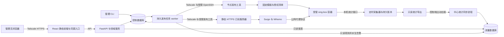
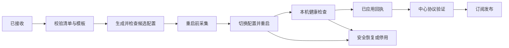

# sbctl 产品开发方案

版本：0.4。更新日期：2026 年 11 月 14 日。状态：F0 前端原型已完成，M0–M6 待实施。

sbctl 用于集中管理约 20 台运行 sing-box 的 VPS，为少量受邀用户提供独立凭证、跨节点流量累计和 Surge、Mihomo 订阅。管理员以 React Web 后台为日常入口，CLI 用于维护与自动化。产品以常驻管理 VPS 为控制端，通过 Tailscale 和受限 OpenSSH 管理节点；节点自行持久保存已经采集的流量，中心负责汇总、配置发布和订阅分发。

本方案覆盖产品范围、技术架构、数据与接口、关键状态转换、故障恢复、开发里程碑及验收。文中的命令和接口是开发规格；任务按实际进度标记，尚未实现的能力不视为可用。

本轮审查的修订依据、验收映射与未决事项见[开发文档审查记录](development-plan-review.md)。0.4 将服务器端业务服务统一为 Docker Compose 部署，补齐权限、持久恢复、统计和接口契约；不代表已完成容器迁移或代码实现。

开发进度：F0 已交付 React 工程、16 个路径的 OpenAPI 草案、22 个 schema 及生成类型、双主题和核心交互原型。运行入口见[项目说明](../README.md)，检查与截图见[F0 验证记录](f0-validation.md)；后端与节点能力仍未接入。

## 一 产品定位与目标

### 服务对象

| 角色 | 主要需求 | 产品入口 |
| --- | --- | --- |
| 管理员 | 添加用户、分配节点、撤销权限、查询流量、维护节点 | Tailscale 内的 Web 管理后台；CLI 支持相同业务操作 |
| 受邀用户 | 导入订阅后使用已授权节点 | Surge 或 Mihomo |
| 运维人员 | 初始化、升级、证书维护、故障恢复 | 独立维护身份与 Ansible |

一期按单一管理主体设计，提供管理员登录，不建设多人协作和多租户权限体系。受邀用户不需要注册账户，也不需要加入 Tailscale 管理网络。

### 核心目标

1. 用一份权威控制数据管理用户、节点、授权和凭证，消除逐台手工修改配置。
2. 每次变更都有可查询的操作编号、节点结果和失败原因，明确哪些节点仍未生效。
3. 已持久保存的流量能够跨内核重启和中心短期离线继续累计，重复同步不重复计账。
4. 订阅只包含该用户已确认可用的凭证，禁用与轮换不会被旧任务或旧文件意外撤销。
5. 管理通道独立于代理服务，代理配置错误时仍保留修复路径。

### 一期成功标准

管理员能够在 Web 后台完成“添加用户、取得订阅、查看累计流量、禁用用户”的完整流程；在一台节点失联、发布回执丢失或内核重启时，系统仍能给出准确的已知状态并恢复执行。桌面和手机浏览器均可完成核心操作。两台试点通过后，按批次推广到全部节点。

## 二 已确定的边界与默认决策

| 事项 | 一期决策 |
| --- | --- |
| 控制端位置 | 常驻独立管理 VPS。Mac 不作为控制端或定时任务执行端 |
| 管理网络 | 各主机独立运行 Tailscale，通过设备标签限制连接 |
| SSH 实现 | 普通 OpenSSH，保留固定命令和独立密钥；一期不启用 Tailscale SSH 接管 |
| 代理内核 | 每节点一个受管 sing-box 容器，内核为容器主进程；不嵌入控制程序，不修改上游源码 |
| 内核构建 | 固定上游版本和提交，保留所需默认构建参数，增加 with_v2ray_api |
| 服务端协议 | AnyTLS、TUIC v5 |
| 用户更新 | 节点固定模板；日常入口只接受用户授权清单和发布元数据 |
| 内核重建 | 受限宿主工具重启登记的 sing-box 容器；镜像升级使用受控 recreate；禁止容器内单独重载内核 |
| 重连影响 | 用户已确认接受新增、禁用及轮换用户时，节点重启导致现有连接短暂中断并重连 |
| 统计 | 节点读取累计计数并持久记账，中心同步持久累计 |
| 统计误差 | 用户要求相对误差不超过 10%；按下述业务字节口径验收，不能把未知故障缺口认定为达标 |
| 禁用执行 | 用户已确认可管理节点立即执行，失联节点在发现管理链路恢复后优先执行；不采用离线授权租约 |
| 订阅 | 直接生成静态 Surge 和 Mihomo 文件 |
| 数据库 | 嵌入式 SQLite 文件，无数据库网络服务；控制库和流量库分离 |
| 管理界面 | 一期自建 React Web 后台，浅色／深色主题及手机适配；CLI 保留；现有 zashboard 仅供受信任管理员诊断 |
| 前端技术 | React、TypeScript、Vite、Tailwind CSS、shadcn/ui；优先采用当前稳定且相互兼容的版本 |
| 管理 API | Python FastAPI；与 CLI 共用领域服务和持久任务，只通过受限管理网络访问 |
| 部署形式 | 服务器端业务服务使用 Docker Compose；Tailscale、OpenSSH、受限节点工具与采集器留在 Linux 宿主机，本机不安装或运行 Docker |
| Python 运行 | 全部通过 uv，项目使用 .venv 和锁文件 |
| 备用用户池 | 一期不做可复用槽位；确有新增免重启需求时再增加不复用的备用身份 |

源码基线采用 sing-box v1.14.4。该版本的 SIGHUP 会关闭并重建实例，因此本产品不承诺用户变更时保留现有连接。配置检查也不执行实例启动，必须另做启动与认证验收。[重载实现](https://github.com/SagerNet/sing-box/blob/v1.14.4/cmd/sing-box/cmd_run.go)、[检查实现](https://github.com/SagerNet/sing-box/blob/v1.14.4/cmd/sing-box/cmd_check.go)。

### 不在一期范围内

- 受邀用户自助注册、套餐、支付、邀请返利和面向公网开放的管理后台；管理员私有 Web 后台属于一期。
- 按流量自动停用用户、精确计费、对齐 VPS 厂商账单。
- 修改内核以实现动态用户接口，或者同时开发原生 API 与 v2ray_api 两套采集后端。
- 承诺内核崩溃前最后一个字节也能保存，或者失联节点能够立即撤销权限。
- 用户访问目标、URL 和业务内容的记录；产品统计只处理身份与字节累计。
- 自动通过消息平台向好友发送凭证。管理员自行交付订阅链接。

### 统计口径

上传指客户端经代理发出的业务字节，下载指代理返回客户端的业务字节。累计包含同一用户在该节点上两种协议的计数，协议和传输开销不与厂商网卡账单等同。

一期以“用户总量”和“用户在各节点的总量”为必选报表，不承诺按协议拆分用户流量，也不把一段失联期间补回的累计差额强行分摊成精确的小时账单。[用户计数实现](https://github.com/SagerNet/sing-box/blob/v1.14.4/experimental/v2rayapi/stats.go)。

用户确定的统计误差要求为不超过 10%。本方案将验收口径具体化为：在同一已声明测试区间，按每个用户在各节点的业务累计，以及该用户的跨节点总量分别核对；比较值为上传与下载之和，两个方向仍须单独记录并核对归属。

```text
相对误差 = abs(系统记录业务字节 - 对照业务字节) / 对照业务字节
验收要求：相对误差 <= 0.10
```

对照值来自可控的实际业务收发测试，统计起止基线、背景流量和必要协议字节计入方式在 M0 固定。测试结束后等待末次采样及中心同步完成再比较，不把显示延迟当作永久漏记；对照值为零时不计算百分比，单独检查是否出现错误入账。10% 容差不允许身份串号、重复计账或历史累计回退。

规定的对照场景覆盖正常传输、受控重启、采集短暂失败及中心离线后恢复，均须实测误差。存在可量化损失时仍计入误差，超过 10% 即不通过；磁盘丢失或未采样尾部等无法量化的情况保留缺口状态，标记为无法证明符合 10% 要求，不能默认损失在容差内。

## 三 产品功能与优先级

P0 是首个可用版本必须完成的能力；P1 在 P0 通过后按实际需求安排。

| 编号 | 功能 | 优先级 | 完成条件 |
| --- | --- | --- | --- |
| FR01 | 节点登记与能力检查 | P0 | 分别记录管理地址和公网协议端点、SSH 指纹、容器绑定、镜像与模板版本 |
| FR02 | 用户新增、禁用、重新启用 | P0 | 身份稳定；禁用立即触发高优先级撤销并保留历史；重新启用使用新凭证 |
| FR03 | 节点及节点组授权 | P0 | 按直接授权与动态组授权的并集计算；生成不可变操作目标，部分成功可查询 |
| FR04 | 安全配置发布 | P0 | 只提交用户清单，具有防退版本、持久回执及认证验证 |
| FR05 | 凭证轮换 | P0 | 支持新旧凭证过渡、失败暂停和紧急撤销 |
| FR06 | 节点持久账本 | P0 | 跨内核重启保留累计，异常计数不会静默写账 |
| FR07 | 中心流量汇总 | P0 | 重复、乱序同步不重复计账；规定对照场景误差不超过 10%，展示新鲜度和缺口 |
| FR08 | 静态订阅生成与发布 | P0 | 支持完整配置和节点列表，内容与已验证授权一致 |
| FR09 | 订阅令牌轮换与吊销 | P0 | 旧令牌不能被旧发布重新恢复 |
| FR10 | 操作查询与恢复 | P0 | 中心重启后继续处理已持久化任务 |
| FR11 | 告警记录与诊断 | P0 | 记录并可确认失联、待撤销、统计缺口、证书及恢复异常；诊断只读 |
| FR12 | 备份与恢复 | P0 | 在测试环境恢复后能识别状态差异，禁止自动覆盖较新状态 |
| FR13 | 按日趋势报表 | P1 | 明确补采与跨日区间的归属规则，不冒充精确时序计费 |
| FR14 | 主动通知渠道 | P1 | 用户选定并配置渠道后启用，消息不含凭证和订阅令牌 |
| FR15 | 不复用的备用身份池 | P1 | 分配基线、补池与退休规则独立验收 |
| FR16 | Web 管理后台 | P0 | 浏览器完成节点、用户、授权、流量、订阅、操作及告警管理；关键状态与 CLI 一致 |
| FR17 | 管理 API 与登录会话 | P0 | 服务端鉴权、请求幂等、字段校验、会话失效及秘密脱敏通过验证 |
| FR18 | 主题、响应式与交互质量 | P0 | 统一组件和设计变量，浅色／深色、键盘和手机核心操作验收通过 |

### 典型用户流程

管理员在 Web 后台或 CLI 添加用户并授权节点组后，系统生成每节点、每协议独立的凭证，提交节点变更，验证新凭证，再发布订阅。接口返回操作编号，Web 展示各节点和订阅阶段；管理员在订阅发布成功后取得链接。

管理员禁用用户时，系统保存禁用意图，立即唤醒高优先级任务执行节点撤销与订阅吊销。两条任务独立推进，任一失败都不能阻塞另一条。失联节点保留待撤销任务，发现链路恢复后优先执行。只有全部目标节点确认撤销、订阅主机确认吊销后，操作才显示完成。

管理员查询流量时，同时看到累计值、统计起点、最近采样时间、最近同步时间和数据质量。失联时保留已有累计，并标为过期；不会用零替代未知值。

## 四 整体架构



图中的统计回传由控制端主动发起 SSH 连接读取，不授权代理节点主动登录控制端。Tailscale 负责管理网络连接，OpenSSH 和节点工具负责命令权限。CLI 直接调用同一领域服务，不依赖 FastAPI HTTP 服务在线；浏览器仅访问管理 API。

### 组件职责

| 组件 | 职责 | 不授予的权限 |
| --- | --- | --- |
| React Web 前端 | 展示状态、提交业务操作、管理表单和数据视图 | 不持有 SSH 私钥、数据库、凭证解密材料，不直接连接节点管理端口 |
| 管理 HTTP API | 管理员鉴权、参数校验、调用领域服务并返回操作编号 | 不提供任意 shell、文件路径、完整配置或数据库查询接口 |
| 控制 CLI | 修改控制数据、查看操作与报表、生成交付链接 | 不提供任意节点 shell 命令 |
| 发布任务进程 | 执行控制库中的持久任务，收集回执 | 不持有日常可用的系统维护私钥 |
| 中心统计进程 | 拉取统计快照，写流量库 | 不读控制凭证库、不持有发布密钥 |
| 节点发布工具 | 验证清单、生成配置、调度受控重启、保存回执 | 不接受模板、程序、任意文件路径或 shell |
| 节点采集器 | 读取本机累计计数及受限运行元数据并提交账本 | 不读用户密码、不修改授权或容器，不访问 Docker socket |
| 节点统计导出工具 | 返回固定格式的已提交快照 | 不访问原始统计 API、不清零或修改账本 |
| 订阅发布工具 | 校验发布版本、安装文件、吊销令牌 | 仅写受管发布目录及非公开安全状态目录，调用方不能指定路径 |
| 维护工具 | 安装镜像、Compose、宿主工具、模板、证书、单元与防火墙 | 维护凭据不交给常驻采集进程 |

### 技术栈

前端采用 React、TypeScript、Vite、Tailwind CSS 与 shadcn/ui。Vite 输出静态单页应用，由管理 VPS 的 Caddy 容器提供 HTTPS 和同源 `/api/v1` 反向代理。FastAPI 在私有 bridge 网络内监听容器的 `0.0.0.0`，不发布宿主端口；仅 Caddy 接入 API 网络。Caddy 的宿主 HTTPS 端口显式绑定 Tailscale 地址，不能在容器内绑定不存在的宿主地址。该管理后台的页面渲染和交互在浏览器完成，部署时无需常驻 Node.js 前端服务。[shadcn Vite 安装](https://ui.shadcn.com/docs/installation/vite)。

shadcn/ui 的基础交互统一选择 Base UI，组件源码放入项目并允许按产品需求修改；Tailwind CSS 通过语义化主题变量控制色彩、布局、间距和响应式样式。使用官方组件与 Blocks 作为起点，保留来源与定制差异；引入新组件时检查实际依赖，避免混用不同基础实现造成交互和样式不一致。[shadcn 介绍](https://ui.shadcn.com/docs)。

控制端采用 Python、uv、FastAPI、Typer、Pydantic 和 SQLite。Web API 与 CLI 调用同一领域服务，复用身份、事务 outbox、授权和统计口径；HTTP 请求只提交持久任务，SSH 和节点变更由 worker 执行。FastAPI 的 OpenAPI 契约用于生成前端请求与响应类型。[FastAPI 特性](https://fastapi.tiangolo.com/features/)。

系统 OpenSSH 作为网络执行器，通过参数数组启动，禁止 shell 字符串拼接；SSH 主机指纹必须预先核实。JSON 和 YAML 使用结构化序列化，Surge 文本使用独立格式化器。

节点工具采用 Go 单独编译为 Linux 可执行文件，提供发布、采集、导出等固定入口，避免在 20 台节点分别维护 Python 环境。节点 SQLite 为程序内嵌存储，不增加数据库服务或监听端口。驱动、gRPC 依赖和工具链在 M0 锁定并验证实际节点架构。

sing-box 作为独立容器镜像构建，镜像包含固定内核和最小启动守卫。控制端与节点工具不会将其作为内嵌服务启动，也不会复制协议入站实现。

### 前端与 API 依赖基线

以下以 2026 年 11 月 14 日查询官方 npm Registry、PyPI 和 Node.js 发行索引得到的版本快照为起点，前端条目已按 F0 实际安装与验证结果回写。精确依赖和锁文件在 `web/`；安装、类型、构建和 Chromium 组件运行检查已通过。FastAPI 仍为后续初始化候选，生产启动不自动升级。

| 职责 | 依赖及候选版本 | 使用方式 |
| --- | --- | --- |
| 构建运行环境 | Node.js 26.12.1、pnpm 12.18.0 | F0 实际使用并验证；固定构建环境，前端发布为静态文件 |
| 界面与类型 | React / React DOM 19.3.1、TypeScript 5.9.3 | React 同版本配对；TypeScript 严格模式，满足类型生成与 lint 工具共同支持范围 |
| 构建 | Vite 8.3.8、`@vitejs/plugin-react` 6.3.0 | 路由分块、开发代理、生产资源构建 |
| 样式 | Tailwind CSS / `@tailwindcss/vite` 4.3.5 | 主题变量、响应式布局、轻量 CSS 动效 |
| 组件代码 | shadcn CLI 4.23.0、`@base-ui/react` 1.9.0 | 官方组件源码按需加入；CLI 版本与生成的组件源码分别追踪 |
| 图标 | `lucide-react` 1.73.0 | 统一 SVG 图标 |
| 页面路由 | `@tanstack/react-router` 1.170.46 | 类型化路由和搜索参数，详情链接与浏览器前进后退 |
| 服务端数据 | `@tanstack/react-query` 5.107.1 | 查询缓存、刷新、失效、进行中操作轮询 |
| 数据表格 | `@tanstack/react-table` 9.3.1 | 与当前 shadcn Table 源码组合，搜索、排序、分页和明确的选择范围 |
| 表单与校验 | React Hook Form 7.92.0、`@hookform/resolvers` 7.0.6、Zod 4.6.7 | 表单状态与客户端输入校验；服务端仍执行独立鉴权和校验 |
| 图表 | Recharts 3.10.1 | 使用 shadcn Chart 样式层展示已有累计数据 |
| 测试 | Vitest 5.1.0、Playwright 1.65.1 | 有业务价值的组件逻辑测试和真实浏览器流程验收 |
| 管理 API | FastAPI 0.162.7 | 与规划的 Python 领域层衔接，Python 及其他依赖在初始化时一并锁定 |

React 官方当前文档版本为 19.3；补丁号以本次注册表快照为准。[React 版本](https://react.dev/versions)、[React 包元数据](https://registry.npmjs.org/react/latest)、[Vite 包元数据](https://registry.npmjs.org/vite/latest)、[Tailwind 包元数据](https://registry.npmjs.org/tailwindcss/latest)、[shadcn 包元数据](https://registry.npmjs.org/shadcn/latest)、[Node.js 发行索引](https://nodejs.org/dist/index.json)、[FastAPI 包元数据](https://pypi.org/pypi/fastapi/json)。

TypeScript 初始候选 7.0.2 不满足 openapi-typescript 的 `^5` peer 范围以及 typescript-eslint 的 `<6.1` 范围，F0 因此锁定共同兼容的 5.9.3。此次采用已有 Node.js 26.12.1 完成验证，未为候选补丁号升级本机工具链。

表格按当前 TanStack Table 9 与对应官方示例实现，不能直接混入 Table 8 的旧模板；图表按当前 Recharts 3 接口实现。F0 用一页实际包含表单、表格、弹窗及图表的组件验收页验证兼容性。[shadcn Data Table](https://ui.shadcn.com/docs/components/base/data-table)、[shadcn Chart](https://ui.shadcn.com/docs/components/base/chart)。

普通交互使用 CSS 动画；需要复杂布局过渡时可按需加入 Motion，当前稳定候选为 14.14.0。服务端数据由 Query 管理，URL 保存筛选及分页状态，局部交互用 React state；一期没有另加全局状态库的必要。所有额外 registry 组件须有明确页面用途和可核对来源。

### 运行服务

- 管理 VPS：Caddy 静态前端与反向代理、FastAPI、发布 worker、统计同步 worker 为不同 Compose 服务，CLI 按需使用同版本控制镜像。
- 代理节点：sing-box 为业务容器；tailscaled、OpenSSH、固定发布 helper、采集 timer 与账本留在宿主机。宿主 systemd oneshot 只调度固定 helper，helper 操作登记的容器。
- 节点发布恢复检查：宿主启动后及定时检查未完成操作，处理提交与 helper 启动之间的崩溃窗口，不依赖 SSH 会话存活。
- 订阅主机：Nginx 或 Caddy 静态服务容器，只读挂载发布目录；tailscaled、OpenSSH 和受限发布工具留宿主机。

业务容器故障不能阻断宿主恢复通道。API 重启不取消已经提交的任务，worker 独立从持久存储恢复；各服务无需浏览器或交互终端在线。

### 容器生命周期与挂载契约

每台节点登记固定 Compose project、service、容器标签及预期镜像 digest；一期每个节点一个 sing-box 实例。日常 helper 不接受调用方指定 Docker 参数、容器名、镜像、挂载或命令。停止、启动、重启、只读运行查询均校验登记对象；维护身份才可变更 Compose 或 recreate 镜像。重启现有容器不构成镜像升级。

Linux 代理节点默认使用 host 网络，延续公网 TCP/UDP 监听及宿主回环统计接口；这会共享宿主网络命名空间，不能声称存在网络隔离，也不同时设置无效的端口映射。管理 API 与 Web 使用前述 bridge 网络方案。[Docker host 网络](https://docs.docker.com/engine/network/drivers/host/)。

控制库、流量库、节点账本、发布状态和证书状态均存放本地持久目录，不落在容器可写层。容器使用明确 UID/GID、最小 capabilities 和所需目录权限；不启用 privileged，不挂载 docker.sock，不把业务或统计账号加入 docker 组。只有受限宿主 helper 可以使用 daemon 管理登记对象；该 helper 属于高权限信任边界。[Docker 安全说明](https://docs.docker.com/engine/security/)。

配置与外部证书挂载稳定父目录，容器侧只读；在目录内原子替换文件。避免把会经 rename 替换的单个文件作为 bind mount，造成容器继续引用旧文件。由内核 ACME provider 写入的状态使用独立可写持久目录，不能将模板或安全状态一并放宽为可写。[Bind mount 说明](https://docs.docker.com/engine/storage/bind-mounts/)。

sing-box 的启动守卫先校验当前配置、镜像兼容性和最新安全状态，再以 exec 启动内核作为主进程。禁止内部 supervisor 单独重启内核及 SIGHUP 重建实例，否则 Docker 周期标识无法对应计数重置。重启策略初选 `unless-stopped`；安全停止后不能被 daemon 重启自动复活，启动守卫仍须覆盖宿主重启和人工启动。[Docker 重启策略](https://docs.docker.com/engine/containers/start-containers-automatically/)。

## 五 身份与权限模型

### 身份不可复用

`user_id` 为不可变内部标识；昵称只用于显示。删除、禁用和重新启用都不改变历史归属。节点使用独立 `node_id`，地址或显示名改变不产生新节点身份；主机替换必须经过显式重新登记。

凭证按 `user_id × node_id × protocol` 隔离。每次轮换创建新的 `credential_id` 和递增代数，渲染配置时不得重新随机生成凭证。订阅令牌与代理凭证完全分开。

AnyTLS 和 TUIC 的服务端统计名统一使用稳定的 `user_id`；同一用户的多份过渡凭证共享该统计名。`stats.users` 由授权清单去重生成，中心只汇总用户计数，不把入站、出站和用户三个维度重复相加。

同名过渡凭证不等于可以复用认证秘密。节点清单须拒绝相同入站内重复的 AnyTLS 密码及冲突 TUIC UUID；AnyTLS 按密码摘要映射用户，重复密码会破坏身份归属。校验、审计与错误信息不得回显密码。[AnyTLS 身份映射](https://github.com/anytls/sing-anytls/blob/v0.0.11/service.go)。

### 控制端权限隔离

| 系统身份 | 可以访问 | 不能访问 |
| --- | --- | --- |
| sbctl-control | 控制库、发布密钥、订阅发布密钥、凭证解密材料；只读流量结果 | 系统维护私钥的长期副本 |
| sbctl-sync | 流量库、统计读取密钥、仅含节点 ID 和地址的采集清单 | 控制库、用户凭证、发布密钥 |
| 管理员维护身份 | 维护任务所需的受控权限 | 不被业务 worker 继承 |

一期 API 作为受信任控制进程使用 sbctl-control 身份，和 CLI 共用控制库；不把同一身份下的不同进程宣称为系统级权限隔离。提供静态文件和反向代理的 Web 服务使用独立账号，只读前端发行目录，不能读取控制库、密钥或订阅文件。

Compose 按身份分别挂载目录与秘密文件；同宿主上的 UID/GID 权限仍需成立。统计同步容器不挂载控制库；API 和控制 worker 对流量卷仅有只读访问。告警及确认状态统一写入控制库，统计同步只提交观测与质量事件，控制 worker 读取后按事件 ID 幂等派生告警。

采集清单由控制端生成，原子写入只读配置，内容仅含采集所需的节点身份、地址和主机指纹，不含代理密码。

SQLite 的权限由文件系统控制，不能靠同一个数据库里的“表角色”隔离采集器。因此控制库与流量库必须使用不同文件和系统权限。[SQLite 权限说明](https://www.sqlite.org/omitted.html)。

### 节点权限隔离

内核运行账号仅有代理运行所需权限；配置和私钥可读，模板和程序不可写。采集账号只读本机统计接口、写自己的账本和导出快照。SSH 统计账号只读导出快照，不直接打开采集数据库，避免为 SQLite 共享文件或锁文件放宽写权限。

SSH 发布账号使用 root 拥有的固定入口和受限提权，只能提交用户清单、查询操作结果。密钥文件与命令包装器不能由该账号修改。维护身份单独负责修改镜像、Compose、宿主程序、模板、监听和路由。

统计账号通过固定 `runtime-status` 入口读取白名单容器的精简元数据，不直接访问 Docker API。该入口只返回完整容器 ID、原样启动时间、运行标志、构建及配置摘要，不返回完整 inspect、环境变量、挂载秘密或日志，不接受任意对象和格式模板。宿主采集器继续独立于业务容器运行。

## 六 数据模型

### 控制数据库

| 实体 | 关键字段 | 约束 |
| --- | --- | --- |
| users | user_id、display_name、status、created_at、revision | 身份不可复用；历史软保留 |
| nodes | node_id、name、tailnet_address、ssh_host_fingerprint、arch、lifecycle、revision、runtime_binding | runtime_binding 固定 Compose project/service、标签及镜像 digest；未通过能力检查不得发布 |
| node_endpoints | endpoint_id、node_id、protocol、public_host、public_port、sni、tls_profile、protocol_options、revision | 维护登记并经实际协议验证；与管理地址分离，普通用户字段不能改监听或 TLS |
| node_groups / node_group_members | group_id、name、membership_revision；group_id、node_id | 成员变更递增版本；每次操作保存实际目标节点集合 |
| user_group_grants / direct_grants | user_id、group_id 或 node_id、protocol、revision | 保留授权来源，组授权动态跟随成员变化；有效授权取所有来源并集 |
| entitlements | user_id、node_id、protocol、desired_state、revision | 组合唯一；期望与已验证状态分开 |
| credentials | credential_id、user_id、node_id、protocol、generation、secret_ciphertext、phase | 同一组合最多保留两代可用过渡凭证 |
| revocations | credential_id、fingerprint、revoked_revision、reason、created_at | 追加记录；已撤销凭证不恢复 |
| operations | operation_id、kind、priority、targets、state、created_at | 操作编号与目标集合不可变 |
| node_operations | node_id、node_revision、request_id、payload_hash、receipt、stage | 节点版本唯一；请求内容不可变 |
| outbox | task_id、operation_id、kind、lease_owner、lease_until、claim_generation、attempts、next_attempt_at | 与控制数据变更同事务创建；领取和提交按领取代数校验 |
| subscriptions | subscription_id、user_id、token_generation、token_hash、token_ciphertext、state | 每用户独立随机令牌；不复用撤销令牌 |
| subscription_releases | user_id、publish_revision、manifest_hash、credential_generations、state、confirmed_at | 清单明确每个节点/协议/凭证代数；只有主机确认的 release 才作为发布依据 |
| credential_transitions | user_id、node_id、protocol、old_id、new_id、first_release_id、published_at、retire_after、state | 每组合最多一个活动轮换；新代首次确认发布后才启动其旧代倒计时 |
| alerts | alert_id、dedupe_key、source_event_id、severity、state、first_seen_at、last_seen_at、ack_by、ack_at | 控制类告警直接写入；统计类幂等派生，确认不代表故障恢复 |
| audit_events | actor、action、target_ids、before_after_summary、result、time | 摘要脱敏，不记录秘密内容 |
| admin_accounts | admin_id、login_name、password_hash、enabled | 单一管理主体；维护 CLI 初始化，服务端安全密码哈希，无公开注册 |
| admin_sessions | session_token_hash、admin_id、expires_at、revoked_at | 浏览器只保存随机会话 cookie，服务端可立即吊销 |
| api_idempotency_keys | admin_id、key、method、canonical_path、payload_hash、result_ref、expires_at | 与业务/outbox 同事务提交；同 key 异内容拒绝，完整响应过期后保留不可复用摘要记录 |

控制数据库保存唯一的用户授权意图。YAML 只用于导入导出，节点文件只代表已接收或已应用的结果，均不能自动覆盖控制意图。

授权来源的并集派生 entitlements；从一个组移出节点不能撤销仍由直接授权或其他组授予的访问。禁用状态优先于所有授权来源，组成员变化不能重新启用用户。成员变化产生新业务操作，不修改历史操作的目标集合；节点退役先撤销授权和订阅，保留统计与审计，不能用删除节点记录掩盖待撤销状态。公网端点及 TLS 变更走维护流程，通过验证后才影响订阅。

### 中心流量数据库

| 实体 | 用途 |
| --- | --- |
| node_ledger_contributions | 按 node_id、ledger_id、user_id 保存节点持久累计贡献 |
| sync_cursors | 保存每份节点账本最后接受的 snapshot_seq、摘要和同步时间 |
| node_observations | 最近采样、连接状态、内核运行标识、错误和新鲜度 |
| data_gaps | 不可量化缺口、统计起点、状态丢失与恢复事件 |
| opening_balances | 管理员显式导入的历史起始余额及来源，默认不创建 |

用户总量优先通过各节点贡献求和得到，不要求再维护一份容易重复累加的独立全局计数。任何缓存都必须能从贡献表重建。

opening_balances 只允许独立维护导入流程写入，日常 Web/API 不直接写流量库。告警派生允许短暂延迟，来源事件与确认状态分开处理；不宣称控制库与流量库之间存在原子事务。

### SQLite 运行与迁移契约

记录 Python 实际 `sqlite3.sqlite_version` 及 Go 驱动实际嵌入的 SQLite 版本，而不只记录包版本。运行库须包含官方 WAL-reset 修复；官方列出的修复版本为 3.51.3 及后续版本，另有 3.44.6、3.50.7 回补。初始化时选用包含修复的受支持版本，并记录编译选项。[SQLite WAL 限制与修复](https://www.sqlite.org/wal.html)。

控制 API、CLI 与 worker 使用短写事务、有界 busy_timeout 和明确的繁忙错误，网络请求不占写事务。迁移通过单写者锁执行，服务在 schema 未就绪时不启动写入；旧程序遇到不兼容新 schema 必须拒绝启动。磁盘满、锁超时和事务失败均不能返回“已接收”。

控制身份读取活跃流量库使用只读连接 `mode=ro`，不能将持续变化的库标为 immutable。writer 负责创建 WAL/SHM 并提供必要读权限；只读启动条件不成立时返回统计暂不可用，或读取 writer 生成的一致性只读副本，不为此授予流量目录写权限。Linux 集成验证 writer 启停、checkpoint 和容器只读挂载行为。每个库独立备份与恢复，不用 ATTACH 假设跨库原子提交。

### 节点存储

- 发布状态库：由特权发布工具维护，保存已接受版本、执行阶段、当前安全授权快照、撤销记录和回执。
- 流量账本：由采集账号维护，保存 ledger_id、来源计数游标、用户持久累计、snapshot_seq 和缺口。
- 导出快照：从已提交账本生成，原子替换；SSH 统计账号只读该文件。
- 固定模板及模板清单：由维护身份写入，记录模板摘要、兼容内核版本和固定入站标签。
- 启动安全清单：宿主 helper 维护的受保护文件，含最高安全版本、撤销约束、允许启动的配置摘要及恢复阶段；容器只读挂载，不能自行改写。
- 无秘密统计清单：预期统计用户集合、stats 配置摘要与配置版本；由当前运行实例的绑定记录确认后供采集器读取，不包含认证秘密。

### 秘密与备份

代理凭证和可恢复的订阅令牌使用成熟库提供的认证加密保存，密钥与数据库分离，并保存 key_id。密钥由受限宿主文件按最小范围只读挂载到所需容器，不放入镜像、环境变量或 Compose 明文；备份时分别保存加密数据和恢复材料。加密不能隔离已经能读取解密密钥的控制进程，权限边界仍以系统账号和主机信任为基础。

所有时间持久化为 UTC，展示时按配置时区转换，默认 Asia/Singapore。字节数使用整数，网络契约使用十进制字符串，禁止经浮点数转换。累计字段应验证非负且不超过存储类型上限。

## 七 管理网络与安全边界

### Tailscale 访问矩阵

| 来源 | 目标 | 允许发起的连接 |
| --- | --- | --- |
| 受信任管理员设备 | 管理 VPS | 管理 SSH 与 Web HTTPS；Web 请求仍须通过应用登录鉴权 |
| 控制端设备标签 | 代理节点标签 | 已登记的 OpenSSH 端口 |
| 控制端设备标签 | 订阅主机标签 | 已登记的 OpenSSH 端口 |
| 管理员维护身份对应设备 | 指定节点 | 维护 SSH；按需允许诊断通道 |
| 代理节点标签 | 其他代理节点或控制端 | 不授权主动管理连接 |
| 普通受邀用户设备 | 管理网络 | 不加入管理网络 |

设备标签建议使用 tag:sbctl-control、tag:sbctl-node、tag:sbctl-subscription。标签所有权仅交给可信管理员；节点注册材料不得允许节点冒充控制端。日常控制程序不持有 Tailscale 管理后台的全局管理令牌。

新策略使用 grants；已有 ACL 可继续使用。实施前先读取现有策略，确认宽泛允许规则没有覆盖这些设备，同时保留无关设备原有权限。策略验收要同时验证允许连接和禁止连接，不能只测试控制端是否连得上。[Tailscale 策略说明](https://tailscale.com/docs/reference/syntax/policy-file)。

一期不启用 Tailscale SSH：它会接管 tailnet 地址的端口 22，连接不再交给普通 OpenSSH。固定命令和 authorized_keys 的限制必须由实际处理连接的服务执行。[Tailscale SSH 说明](https://tailscale.com/docs/features/tailscale-ssh)。

### 系统与代理流量隔离

- tailscaled 作为独立系统服务运行，不使用 sing-box 内部端点承载管理网络。
- 节点不充当 Tailscale 出口节点或子网路由器。代理业务继续走节点原有公网路径。
- 一期节点登记保存稳定的 Tailscale 地址。代理节点默认不让 Tailscale 接管系统 DNS，避免更改现有解析行为。
- 公网 SSH 在 Tailscale 正向、反向限制及云控制台恢复路径通过验证后再关闭；同时检查公网 IPv4 和 IPv6。
- 原始 v2ray_api 仅监听回环地址，按本机进程或账号限制访问。中心读取账号只访问账本导出，不获得原始 API 访问或端口转发能力。
- host 网络容器共用宿主网络；统计接口访问规则须用实际宿主 UID/cgroup 验证，不能只凭容器名认定隔离有效。检查公网 IPv4/IPv6 上不存在统计 API 或 Docker API 入口。
- OpenSSH 固定命令不能执行 SSH_ORIGINAL_COMMAND 的任意内容，也不能接受远端指定的路径、程序名、环境变量或 shell 片段。

代理用户的目标地址要覆盖回环、私有网、链路本地、云元数据、节点自身管理地址、控制端和订阅主机管理地址。Tailscale 使用的 IPv4 范围 100.64.0.0/10 和 IPv6 范围 fd7a:115c:a1e0::/48 要明确纳入限制。[Tailscale 地址范围](https://tailscale.com/docs/reference/reserved-ip-addresses)。

域名目的地应检查最终解析地址，不能只拒绝字面 IP。系统防火墙的进程出站规则若涉及本地解析器，应只允许指定解析器及端口；这不改变代理用户访问私网目标的拒绝规则。两层规则分别验收。

### 凭证暴露范围

节点被控制后，其自身统计和凭证不再可信，但不应因此取得其他节点的 SSH 私钥或代理凭证。控制端的发布进程有管理全部用户授权的能力，仍属于高信任组件；Tailscale 不会消除控制端失陷的影响。

订阅服务器保存可用代理凭证。TinyFileManager 不得拥有订阅目录的读写权限；共享宿主时也要使用不同账号与目录权限。备份、历史文件、数据库和临时配置均放在 Web 根目录之外。

## 八 节点命令与数据契约

### 固定入口

| 入口 | 身份 | 输入 | 输出 |
| --- | --- | --- | --- |
| submit-users | 发布身份 | 有界 JSON 用户清单与请求元数据 | 是否接收、请求编号、当前节点版本 |
| operation-status | 发布身份 | 已知请求编号 | 执行阶段、配置摘要、内核标识、错误类别 |
| node-status | 状态读取身份 | 固定查询 | 程序与模板版本、服务状态、未完成操作 |
| ledger-export | 统计读取身份 | 固定查询 | 已提交账本的完整导出快照 |
| collect | 本机采集账号 | 固定本机配置 | 更新账本与导出；不对 SSH 统计身份开放 |
| runtime-status | 本机采集账号经受限入口 | 固定登记对象 | 精简容器状态、source_epoch 及无秘密统计清单绑定 |

协议使用标准输入传递 JSON，标准输出只输出契约 JSON，诊断输出经脱敏后进入标准错误或日志。密码不放入命令行参数。输入、输出和错误都有大小限制；未知字段、重复凭证 ID、同入站重复 AnyTLS 密码、冲突 UUID 和超长字符串直接拒绝。同一 user_id 因不同协议或两代轮换凭证重复出现是合法情况，不能误判为重复身份。

### 用户清单请求

请求至少包含以下字段：

| 字段 | 含义 |
| --- | --- |
| schema_version | 传输契约版本 |
| node_id | 目标节点固定身份 |
| request_id | 同一个逻辑请求重试时保持不变 |
| node_revision | 该节点控制请求的递增版本 |
| base_applied_revision | 生成请求时观察到的已应用版本 |
| template_hash | 期望节点已安装的固定模板摘要，不携带模板内容 |
| engine_build_id | 期望兼容的内核构建标识 |
| payload_hash | 规范化请求内容的 SHA-256 摘要 |
| users | user_id、protocol、credential_id、generation 和协议所需凭证 |
| revoked_credentials | 本次撤销的凭证身份及必要的防重放指纹 |

用户清单按入站的固定协议映射到节点模板，不接受路由、出站、监听端口、日志路径、证书路径或额外服务。Node ID、模板及内核兼容条件不匹配时拒绝写入。JSON 必须通过类型化结构处理，不能把用户输入作为模板代码执行。

请求规范化方式随 schema_version 固定；Python 与 Go 使用相同契约夹具验证摘要一致，不直接依赖各语言默认 JSON 输出。payload_hash 排除自身，覆盖其余业务字段与身份、版本、请求编号等关键元数据。时间戳不作为发布顺序依据，顺序由持久递增版本控制。

### 回执

回执包含 request_id、node_revision、payload_hash、stage、applied_revision、config_hash、engine_build_id、image_digest、source_epoch、applied_at、last_error_code 和安全恢复结果。`source_epoch` 为完整 container_id 与原样 container_started_at 的二元组。失败信息只返回可操作的类别与脱敏摘要，不回显完整配置。

节点的 applied 表示本机已完成启动检查；中心的 verified 表示目标凭证的实际协议检查也已通过。中心只能把与当前节点版本、配置摘要、镜像和 source_epoch 一致的测试结果标记为 verified。容器 running 不能单独证明新配置或撤销已生效。

### 统计快照

| 字段 | 含义 |
| --- | --- |
| schema_version、node_id | 契约与节点身份 |
| ledger_id | 持久账本身份，不随内核重启改变 |
| snapshot_seq | 账本更新序号，持久递增 |
| sampled_at、exported_at | 最近成功采样与本次导出时间 |
| source_epoch、config_hash | 最近成功采样对应的容器运行周期及配置绑定 |
| users | 每个 user_id 的持久 upload_bytes 和 download_bytes |
| data_quality | 独立的 integrity_state、历史缺口标志与累计缺口数量；采样新鲜度由观测单独计算 |
| recent_gap_events | 有界的近期事件，使用不可变事件 ID 去重 |
| checksum | 规范化快照摘要，用于识别同序号不同内容 |

快照包含该账本所有已记录用户的累计，包括已禁用用户。不能因为当前用户清单删除了某人，就从累计导出中移除其历史贡献。近期事件可按保留期裁剪，但累计值、统计起点和历史缺口标志必须保留。

## 九 配置发布与恢复

### 中心任务提交

修改授权、创建凭证、保存撤销意图及创建 outbox 任务必须在控制库同一事务中完成。CLI 返回成功接收后，任务即使尚未执行也不会因进程退出消失。

worker 用短事务领取任务并保存租约和递增 claim_generation；分配节点版本、保存请求、发送前检查及提交结果均核验当前领取代数。失去租约的 worker 停止发起新副作用，不能另分配更高版本覆盖新意图。网络调用在事务之外执行；接管沿用已保存的同一逻辑请求，不重新生成凭证。已经在途的旧请求仍由节点版本防退和串行锁兜底，不能仅依赖中心租约。

发送前重新读取用户状态、授权 revision 和撤销集合，过时任务标为 superseded 并对账。禁用之后的新请求必须包含最新撤销约束；操作重试不能把请求创建时的旧授权当作当前意图。

禁用或撤销事务提交后立即唤醒高优先级 worker，不等待节点采样、中心统计同步、普通发布批次或凭证轮换过渡期。唤醒只是加速信号，持久 outbox 仍是任务依据；信号丢失及 worker 重启由独立的任务恢复检查兜底，不能依赖 60 秒统计同步触发撤销。M0 先定候选间隔与超时，M2/M5 用实现测量并冻结正常触发及故障恢复的完成时限。

### 节点阶段



1. 接收工具校验格式、身份、摘要、版本和兼容性，在节点持久保存已接受请求及撤销约束。
2. 宿主固定 helper 取得节点锁，使用当前维护模板渲染 JSON。用户清单只填入允许的位置；关键切换前复核最新已接受安全版本，被更新请求替代的旧候选不能继续切换。
3. 使用与目标服务相同镜像 digest、账号、工作目录及文件访问条件的一次性预检容器执行 sing-box check，不打开生产入站。候选配置及临时文件不可被非授权账号修改；预检不能替代真实启动检查。
4. 尝试一次重启前采集，与定时采集共用采集锁。禁用或撤销时采用有界锁等待与采集超时，失败记缺口并继续执行，不因统计故障无限阻塞撤销。
5. 按下述持久提交顺序在同一文件系统切换候选配置及安全清单，并由 helper 重启登记的 sing-box 容器；容器挂载稳定父目录以读取新文件。
6. 检查容器状态、目标监听、镜像、构建及新的 source_epoch，将通过启动守卫的运行实例与所用配置和统计清单摘要绑定，持久保存本机回执。仅检查磁盘上文件的新摘要不足以证明运行实例已加载。
7. 中心读取回执并执行真实协议测试。通过后标记对应授权和凭证为已验证。
8. 订阅 worker 只使用已验证的凭证发布文件；失败保留独立的待发布状态。

执行 helper 由宿主 systemd 管理，不依赖 SSH 会话或业务容器存活。提交后连接断开不终止已保存的操作；恢复检查负责补上“请求已保存但执行 helper 尚未启动”等中间状态。

### 文件与安全状态的持久提交

原子 rename 只保证可见性，不能单独保证断电恢复。文件与 SQLite 之间也没有跨介质事务，必须记录可恢复的阶段：

1. 在节点锁内先将请求及摘要写入状态库的接收中阶段；随后持久安装含最新撤销约束、暂不允许新启动的 preparing 启动清单，最后提交已接受版本与执行阶段。两次持久写入均完成后才返回“已接收”。守卫只依赖启动清单判断是否允许启动，跨状态库与文件的对账由宿主 helper 完成；接收中请求的崩溃恢复同样使用原请求编号，不降低已接受安全版本。启动屏障不等于停止当前仍在运行的旧容器，该异常取舍仍遵循下述撤销预检失败策略。
2. 在稳定挂载目录内写候选文件，完成内容检查和文件 fsync；记录候选及期望旧配置摘要。
3. rename 切换文件后 fsync 父目录，按同样方式持久安装只允许目标配置的安全清单；再记录 switched 阶段。
4. 重启并验证实际实例，最后保存 applied 回执。任一步骤中断，按阶段、文件摘要和运行绑定对账，不能跳过执行或无条件重复重启。

启动守卫读取受保护的静态安全清单，不要求业务容器打开宿主可写数据库。缺失、摘要不匹配、阶段不允许或镜像不兼容时拒绝启动；守卫自身不能修复或降低最高安全版本。宿主 helper 依据持久状态完成恢复，不复制旧授权绕过守卫。文件与父目录的持久要求以 Linux 文件系统验证为准。[fsync 说明](https://man7.org/linux/man-pages/man2/fsync.2.html)。

### 防退与幂等规则

- 同 request_id、同摘要：查询或恢复已有操作，不新建副作用。
- 同 request_id、不同摘要：拒绝。
- 低于已接受安全版本的清单：拒绝，即使中心声称是回滚。
- 同版本不同内容：拒绝。
- 相同版本但上次停在中间阶段：按记录恢复，不能仅凭版本号跳过。
- 基础已应用版本发生变化：返回冲突并重新对账；不能盲目覆盖。
- 重新启用用户必须创建新凭证代数，已撤销的凭证不能因再次启用而复活。
- 晚到的旧回执不得覆盖更新版本的实际状态。

网络重试沿用同一节点请求。若状态冲突要求修改基础版本或清单，必须对账后创建新的节点请求和递增版本，关联同一个上层业务操作；不得修改旧请求的内容或重新生成已有凭证。旧节点请求保留被拒绝或被替代的记录。

### 安全恢复

候选检查失败且尚未切换时，普通新增保留当前服务。若本次包含撤销，必须显示 `revoke_blocked` 和高优先级告警，不得报完成。**此时是否强制停止仍在运行的整个 sing-box 容器尚待用户选择**：保留旧服务会让被撤销用户暂时仍能使用；强制停止会中断该节点全部用户。该异常分支在 M2 开发前确定，不能把“接受正常重启重连”解释为已同意此处停服。

切换后本机启动失败时，可回退到已验证的程序或模板，但必须结合最新已接受的安全授权状态重新生成配置。不得直接复制包含旧授权的完整备份。无法生成可启动且不恢复撤销凭证的配置时，保持受影响服务停止并告警。

容器被安全停止时记录原因；未经安全恢复，不因 Docker daemon 重启、宿主重启或调度重试自动加载旧配置。单纯停止容器只能说明该节点当前无法提供代理服务，不能冒充“新授权配置已验证且其他用户可用”。

网络探测超时只代表验证未知，不触发无条件反复重启。已应用但未通过中心验证的操作保持 applied_unverified，恢复后重新检查当前版本。中心重启、重新连接和单次重试都不得导致连续重启风暴。

### 协议验证

验证目标使用实际公网域名、端口、证书与协议。探针启动全新的客户端会话，禁止借用已经认证的连接池。通过受控目标的请求与响应检查实际代理可用性，不能只检查 TCP 端口或 TLS 握手。

新增及轮换时测试新凭证；撤销时结合当前配置绑定、新运行周期、有效凭证对照和旧凭证失败结果判断。单独一次超时不能判定撤销成功。长连接与 QUIC 会话在重启后的终止行为列入试点验收。

未发生凭证变化的用户由配置集合一致性检查和保留用户探针验证；不要求每次小变更重新向所有用户发布订阅。运维探针使用独立保留身份，流量不计入好友用量。

### 发布并发

普通变更默认先验证 1 台，再以最多 3 台并发推进。禁用用户和指定凭证撤销统一走高优先级路径，默认最多 10 台并发，不等待普通发布的单台试点阶段；暂停目标节点上尚未开始的低优先级旧任务，并用包含最新意图的清单替代。

已进入节点配置切换的操作仍遵守串行锁，在安全阶段交接给最新撤销任务，不强行打断原子切换。并发占满、节点锁占用及网络调用均可能产生实际执行延迟，必须记录；“立即执行”表示不设置业务等待期，不代表全部节点在同一时刻零延迟完成。失联节点单独重试，不占用可管理节点的全部执行名额。

已接受版本是否被更高版本覆盖必须有明确记录。旧操作可以标为 superseded，但只有更高版本已验证覆盖其业务目标时，才能把原请求的业务目标认定为完成。

## 十 用户与凭证生命周期

### 新增用户

创建永久 user_id，确定本次授权目标集合，为每个节点和协议生成独立凭证，保存后排队发布。凭证只有一次生成，所有重试使用同一份记录。

允许部分节点完成后生成仅包含已验证节点的订阅，但 CLI 必须标明“部分就绪”。尚未确认的新节点不能进入订阅。临时健康检查失败也不能自动删除此前已验证且未撤销的旧节点凭证，授权与可达性分别展示。

### 禁用用户

中心原子保存禁用状态和各凭证撤销记录，分别创建高优先级节点任务和订阅吊销任务，并立即触发执行。不等待订阅主机可达才撤销节点，也不等待全部节点成功才吊销订阅；禁用不适用普通轮换的 24 小时过渡期。

“即刻生效”按用户确认落实为可管理节点立即执行撤销：从所有相关节点的实际配置移除该用户全部有效凭证，再重启这些节点上受管的 sing-box 容器，使旧连接终止，验证旧凭证不能建立新的有效会话。仅删除中心用户记录后重启旧配置不会撤销访问；不操作无关业务容器。若用户授权覆盖全网，目标就是全部受管 sing-box 容器。该重启对其他用户的连接影响已获用户接受。中心保存禁用状态的时间、每节点开始执行时间、实际应用时间和验证确认时间分别记录，不能把“已接收”显示为“已生效”。

最终状态区分：中心已禁用、节点撤销进度、订阅吊销进度。只要有相关节点未确认，显示“仍有节点待撤销”。失联节点的撤销没有固定时间上界；发现管理链路恢复后先对账并执行最新撤销意图，再处理该节点的普通待办。恢复期间不得重放旧授权。一期不引入会在管理链路中断后自动让所有用户过期的租约机制。

### 普通凭证轮换

```text
创建新代凭证
→ 节点同时接受新旧凭证
→ 新凭证验证通过
→ 原订阅地址发布新内容并确认成功
→ 开始过渡期
→ 删除旧凭证并验证
```

默认过渡期为对应新代凭证首次确认发布后的 24 小时，可配置。以 `user_id × node_id × protocol × new_generation` 单独记录首次成功 release、published_at 和 retire_after；该 release 必须确实包含此已验证新凭证。A 节点成功不会启动尚未就绪的 B 节点倒计时，同 release 重试或无关订阅更新也不延长已启动的过渡期。回执丢失时先查询主机持久发布记录，不以重试响应时间重新计时。

下载过订阅不等于客户端已经加载，过渡期结束仍可能使长期未更新的客户端需要手动更新。Surge 的托管配置更新依赖主 App 运行，不能以设置的间隔保证准时迁移。[Surge 托管配置说明](https://manual.nssurge.com/profile/managed-profile.html)。

订阅发布失败时不启动旧凭证删除倒计时。每个用户、节点、协议最多一个正在进行的轮换流程；再次轮换返回现有操作，不生成第三代并存凭证。TUIC 过渡期使用可并存的新 UUID 与密码组合。

到期删除旧代前重新读取最新用户状态、授权和轮换代数；禁用、紧急撤销及更新版本优先，旧定时任务不能写回包含已撤销凭证的清单。新旧代的实际同时认证及统计归属属于 M0 试点，最终轮换流程在 M4/M5 验收。

### 紧急撤销与重新启用

泄漏的凭证立即进入撤销流程，不保留过渡期。重新启用用户生成新的凭证，历史用量仍归原 user_id，旧凭证保持撤销。

订阅令牌轮换只改变下载入口，客户端需要取得新链接；它不会自动让已经下载的代理密码失效。若令牌泄漏，应由操作范围明确是否同时轮换相应代理凭证。

### 备用身份的后续扩展

只有当新增用户频率或免重启要求足以抵消复杂度时，才增加小批量预置身份。预置身份已经具备服务端认证能力，分配前不交付秘密。身份分配给一人后永久绑定，退休后不复用统计 ID。补池、分配基线、异常未分配流量和凭证轮换需单独验收。

## 十一 节点持久记账与中心同步

### 两层标识

内核运行周期 `source_epoch = (container_id, container_started_at)`，使用完整容器 ID 与 Docker `State.StartedAt` 原样值，不截断秒或转换为本地时区。restart 通常保留容器 ID，recreate 则更换 ID，因此不能只用 ID，也不能只用 RestartCount。受限 helper 查询固定 container 类型，不接受任意 inspect 模板。[Docker inspect](https://docs.docker.com/reference/cli/docker/inspect/)、[Docker 状态字段](https://github.com/moby/moby/blob/master/api/swagger.yaml)。

采样前后均须确认 Running=true、Paused=false、Restarting=false，标识非空且相同，并匹配配置与统计清单绑定；不稳定时丢弃混合样本。该判据依赖第四章的“内核就是容器主进程、禁止内部重载”约束，若发现违反则暂停新增入账并告警。它不统计未观察到的中间重启次数。

账本使用独立 ledger_id，从创建开始持续使用。内核重启只改变来源计数周期，不改变账本身份，也不清空已经提交的用户累计。账本丢失或恢复到旧状态需要显式恢复处理，不能静默创建新 ID 后把内核全部累计再次入账。

### 节点采样事务

1. 取得采集锁，经受限 helper 读取 source_epoch E1、运行状态与无秘密统计清单绑定。
2. 使用 reset=false 查询用户累计计数，匹配前缀固定为用户统计，不请求清零。
3. 再次读取运行标识 E2、运行状态和配置绑定。E1、E2 或绑定不同、运行状态不稳定则丢弃本次结果并有限重试。
4. 校验计数键、重复项、范围和预期统计配置。未知身份先保留为待映射记录，不擅自授予权限。
5. 开始账本写事务，读取上次来源游标，计算差额，同时更新用户累计、游标、质量事件和 snapshot_seq。
6. 提交成功后，从提交状态生成快照并原子替换导出文件。

同一运行周期、同一用户、同一方向的计算为：

```text
新增业务字节 = 当前内存累计 - 上次已提交来源累计
持久累计 = 上次持久累计 + 新增业务字节
```

同一个来源键不能因为在响应中出现两次而相加。计数下降不自动当成重启，也不能先取 max(差额, 0) 再回退游标；应冻结受影响序列的新增入账并报告异常，直到确认恢复边界。统计异常不自动反复重启代理服务。

用户 counter 按实际路由流量延迟创建，因此“没有返回 counter”不能一律解释为零。仅当运行绑定和 stats 配置均已确认、该用户属于预期统计集合、此周期对应方向从未出现 counter 时，才可记为尚无已观测流量；曾出现的 counter 消失、统计清单未知或响应不完整时保留旧游标并报告异常。有效零计数与配置缺失要分开验收。[Counter 创建与查询实现](https://github.com/SagerNet/sing-box/blob/v1.14.4/experimental/v2rayapi/stats.go)。

SQLite 账本使用本地持久磁盘、事务和与持久性目标一致的同步设置；默认 WAL、synchronous=FULL。启动时验证实际设置，写失败不得推进游标或导出序号。SQLite 文件不放在网络文件系统上。[SQLite WAL 说明](https://www.sqlite.org/wal.html)。

### 统计起点

| 场景 | 入账规则 |
| --- | --- |
| 本产品管理下新启动的内核周期 | 从该周期零点计算，首次采到的累计应入账 |
| 首次接管已有运行实例 | 默认把首次读数作为基线，从接管时开始统计，不推断之前的历史 |
| 采集暂停后仍是同一内核周期 | 补回累计差额，不按暂停期间采样次数重复增加 |
| 已存在账本，内核运行周期变化 | 保留旧持久累计，新周期从零计；旧周期尾部标为可能缺失 |
| 中心暂停、节点持续采样 | 恢复后读取持久累计补回，节点重启不清除已保存部分 |
| 节点账本丢失但内核仍在运行 | 禁止把内核全部累计再次计算；先恢复可证明基线，否则建立新统计起点并标缺口 |

重启前补采可以缩短尾部窗口，但采样之后仍可能产生字节。因此运行周期变化时，保留最后成功采样到旧周期结束之间的可能缺口。中间经历多次未观察到的重启时，只报告存在未覆盖区间，不编造重启次数或缺失字节数。

### 快照一致性

账本中的累计和游标在同一事务提交。导出文件在事务之后生成，失败时可以暂时保留上一版快照，但不能回滚已提交累计。下次采集或导出修复从账本重建。

snapshot_seq 随持久状态变更递增，包括采样时间、质量状态和累计变化。校验摘要只覆盖该序号对应的稳定账本内容；传输时生成的 exported_at 等外层信息不参与状态摘要，避免同一序号出现不同哈希。

无需为了每 15 秒采样永久插入全量历史行。节点保留当前来源游标、持久用户累计、必要的运行周期摘要和缺口；一期长期账本的主要行数随身份数量增长。

### 中心同步事务

中心通过只读 SSH 入口读取快照，验证主机身份、node_id、ledger_id、序号、摘要和计数范围后处理：

- 同账本、同序号、同摘要：重复读取，不增加累计；仅更新通信观测。
- 同账本、更旧序号：作为迟到快照忽略，不回退游标。
- 同账本、同序号、不同摘要：记录契约冲突，不入账。
- 同账本、更高序号但累计下降：拒绝更新并告警，不扣减历史总量。
- 同账本、更高且合法序号：在一个流量库事务中替换节点贡献、更新同步游标和缺口状态。
- 不同账本 ID：进入账本更换检查，保留旧贡献，按已确认恢复边界接入新贡献。

导出是完整累计快照。新快照缺失历史用户时不能把其贡献删除，必须报告导出完整性异常。中心统计结果不会因为控制库禁用或重命名用户而归零。

完整累计快照可以反复读取，不需要给统计 SSH 身份增加删除账本或确认清理的权限。若后续加入事件级同步，确认与清理协议另行设计，不能改变累计不丢失的约束。

### 新鲜度与数据质量

| 维度与状态 | 用户看到的含义 | 恢复规则 |
| --- | --- | --- |
| freshness=current / stale / unknown | 采样与同步及时、过期或无法判定 | 按采样进展、中心接收时间及可信时钟重新计算 |
| integrity_state=ok / counter_error / state_lost | 当前计数处理正常、异常或账本状态丢失 | 异常暂停受影响序列新增，修复后更新当前状态 |
| has_historical_gap、gap_count | 某个周期尾部或未覆盖区间可能丢失 | 独立长期保留，不因恢复采样或关闭告警而清除 |

三个维度可以同时成立，例如“数据当前、当前计数正常、历史有缺口”。报表把“节点最后采样”和“中心最后同步”分开展示。每个累计值都附带统计起点；存在不可量化缺口时显示“已记录累计”及缺口提示，不将未知损失显示为零。

中心保存自身接收时间、节点原始时间及可检测的时钟偏差。重读同一快照不能刷新“最后成功采样”；节点时间明显偏移时 freshness 标 unknown 并告警，不能仅凭未来 sampled_at 判为新鲜。时钟偏差不改变版本顺序、快照去重和整数累计规则。

### 周期与保留策略

| 项目 | 初始值 |
| --- | --- |
| 节点采样周期 | 15 秒，可配置为 15 至 60 秒 |
| 中心同步周期 | 60 秒，可配置为 60 至 300 秒 |
| 节点采样陈旧阈值 | 45 秒 |
| 中心同步陈旧阈值 | 180 秒 |
| 正常采样历史快照 | 默认不永久追加 |
| 节点详细运行与缺口事件 | 90 天；累计及历史缺口标志长期保留 |
| 中心操作与审计摘要 | 180 天，按实际运维需要调整 |

陈旧阈值随采样配置联动，不能改变周期后继续使用旧阈值。定时器的精度、执行耗时和失败都纳入新鲜度判断；不能仅凭“配置了 15 秒 timer”声称每 15 秒成功采样。

100 Mbps 持续流量下，15 秒未保存部分约为 187.5 MB，60 秒约为 750 MB，300 秒约为 3.75 GB。这是说明采样窗口的算例，不是任何故障下的损失上限；15 秒采样本身不能证明误差不超过 10%。试点按已声明的业务对照区间实测，再调整采样与重启前补采参数。

## 十二 订阅产品与发布协议

### 输出类型

| 文件 | 用途 |
| --- | --- |
| surge.conf | 可直接导入的最小完整 Surge 配置 |
| surge.list | 给已有规则配置使用的 Surge 节点列表 |
| mihomo.yaml | 可直接导入的最小完整 Mihomo 配置 |
| mihomo-provider.yaml | 供 proxy-provider 引用的节点集合 |

统一控制数据与策略意图，分别渲染两种客户端格式。一期完整模板提供节点选择与基本代理能力，不自动引入复杂第三方规则订阅或在线转换服务。外部节点列表的更新路径与认证信息必须来自本用户的订阅记录。

Surge 的 TUIC v5 使用 tuic-v5，Mihomo 使用 type: tuic，并使用 UUID 与密码。AnyTLS、TLS 参数及 UDP 能力由两台试点固定客户端版本验证。Surge AnyTLS 的文档最低版本为 iOS 5.17.0、Mac 6.4.3；这是客户端兼容条件，与控制端部署位置无关。[Surge TUIC](https://manual.nssurge.com/policies/tuic.html)、[Surge AnyTLS](https://manual.nssurge.com/policies/anytls.html)、[Mihomo TUIC](https://wiki.metacubex.one/en/config/proxies/tuic/)、[Mihomo AnyTLS](https://wiki.metacubex.one/en/config/proxies/anytls/)。

### 内容安全

默认启用证书验证，禁止为了测试通过自动加入 skip-cert-verify 或 insecure。显示名称不能向 Surge 配置注入换行或分隔符；YAML 使用安全序列化与解析验证。完整配置中的管理监听保持本机范围，不默认开放客户端 LAN 管理接口。

节点地址、端口、SNI、协议参数来自维护配置。日常用户字段不能变成任意出站、规则或远程代码内容。渲染完成后校验节点引用、策略组引用、凭证代数和必要字段，再生成发布清单。

### 发布原子性与防退

订阅主机通过受限工具接收 subscription_id、token_generation、publish_revision、内容摘要及固定文件集合。工具不得接受任意相对路径、绝对路径或额外文件名。

先在非公开暂存目录写入并校验整组文件，完成文件与目录 fsync，再原子切换该用户的当前版本并持久化父目录。单次读取只会看到完整旧文件或完整新文件；跨多个 HTTP 请求可能跨越发布时刻，固定文件集合与凭证过渡须允许这种情况。状态库放在 Web 根目录之外，记录已接收版本、prepared/switched/confirmed 阶段、manifest 摘要及令牌撤销记录。

切换目录与状态库提交之间崩溃时，按持久阶段与当前 manifest 对账并补写同一发布回执。撤销记录先持久保存，再删除公开入口并持久化目录；删除失败保持 revoke_pending。静态容器只读挂载稳定发布父目录，不能挂载会被替换的单个文件。恢复旧卷前必须按第十六章停止公开入口，避免撤销链接短暂复活。

同请求相同内容重试查询既有结果；低版本发布拒绝。令牌已经撤销后，迟到的发布任务不得重建其目录。中心恢复旧备份，也不能用旧令牌和旧发布状态覆盖订阅主机的较新撤销记录。

公开路径可采用 /s/<随机令牌>/surge.conf 等形式。令牌使用至少 32 字节密码学随机数，与用户名、UUID 和节点密码无关。访问日志不保留完整令牌路径；关闭目录列表和脚本执行，只允许所需的静态读取方法。响应采用避免共享缓存的策略，历史版本不得有可公开枚举的入口。

### 状态与失败处理

订阅状态包括 pending、published、revoke_pending、revoked 和 failed。静态主机未确认删除时，中心不能显示 URL 已失效。节点撤销与订阅吊销分别追踪，不假设跨主机存在一个原子事务。

普通凭证轮换按第十章逐节点、逐协议、逐新代凭证启动过渡期；发布成功但未包含某个新凭证时，不启动其旧代删除。订阅发布失败不提前撤销旧凭证。紧急禁用继续优先撤销节点，直到两侧都确认才结束操作。

## 十三 证书与内核升级

### 证书责任

每个节点登记固定域名、SNI、证书来源、续期责任和证书到期时间。优先使用每节点独立私钥，减少共享证书私钥泄漏的范围。日常发布账号不接触 DNS 管理令牌或证书私钥路径。

使用 sing-box 内置签发时采用新的 ACME certificate provider；tls.acme 在 1.14 弃用并计划在 1.16 移除。若现有外部续期流程可靠，也可以继续使用受控证书文件路径。[证书迁移说明](https://sing-box.sagernet.org/deprecated/#inline-acme-options-in-tls)、[TLS certificate provider](https://sing-box.sagernet.org/configuration/shared/tls/#certificate_provider)。

DNS01 凭据只授予必要范围；不能把全域 DNS 管理密钥复制到全部代理节点。无法提供适当范围时，签发和分发交给独立维护流程。M0 必须选定实际挑战方式和续期流程，避免临时增加未经规划的公网管理入口。

到期剩余 14 天产生预警，剩余 3 天升级严重程度。续期后验证新连接使用的证书、域名匹配和完整链。是否需要单节点重启由选定的证书更新机制决定，不无条件对全部节点重启。

管理 Web 私有 HTTPS 单独登记证书方案：选用宿主 Tailscale 证书签发/续期并只读挂载 Caddy，或可验证的 DNS01 流程。不能假设 bridge 容器自动访问宿主 tailscaled，也不为取得证书临时向公网开放管理端口。Caddy 默认可能监听全部地址，因此必须检查宿主端口绑定及 IPv4/IPv6 暴露；Tailscale 地址未就绪时等待或报错，不回退为公网监听。[Caddy 自动 HTTPS](https://caddyserver.com/docs/automatic-https)、[Caddy 监听地址](https://caddyserver.com/docs/caddyfile/directives/bind)。

### 可追溯构建

每份内核镜像记录上游 tag、commit、Go 工具链、构建标签、目标架构、二进制摘要、基础镜像 digest、最终镜像 digest、启动守卫版本和构建时间。保留该版本需要的默认构建能力后增加 with_v2ray_api，不只保留一个统计标签。

以 v1.14.4 的 go.mod 为基线，构建工具链须满足其 Go 版本要求；具体受支持补丁版本和依赖锁定在构建记录中。[上游构建要求](https://github.com/SagerNet/sing-box/blob/v1.14.4/go.mod)。

只构建登记节点实际需要的 Linux 架构，默认验收 amd64、arm64。镜像在 Linux CI 集中构建并分发，节点不安装编译环境，本机不运行 Docker。Compose 引用不可变 digest，不能用浮动标签代表已验收版本；发布前检查版本、统计接口及 AnyTLS、TUIC、Clash API 所需能力。

### 升级与回退

内核升级由维护身份更新镜像 digest 并 recreate 固定服务；普通 restart 只重新加载当前镜像与持久配置。宿主节点工具使用版本目录和受控版本指针。日常发布工具不能改镜像或程序路径，禁止无人值守更新覆盖已验证构建或删除状态卷。

升级采用 1 台试点、少量节点、全部节点的顺序。新内核、新模板与节点工具之间有兼容矩阵。回退只在兼容范围内进行，并继续保留最新授权与撤销记录；不支持把新数据结构直接交给不兼容旧程序。

v2ray_api 的未来去向不作为当前已知弃用事实。实现上隔离统计读取适配器；只有上游接口发生实际变化时，才立项迁移并重新验证记账语义。

## 十四 Web 管理后台与 CLI

### 视觉与布局

默认采用简洁的运维控制台风格：石板灰背景、青绿色主操作、清晰数据层级和克制的边框与阴影。浅色／深色主题同时设计，首次跟随系统，可手动切换。中文界面优先；正文使用系统无衬线中文字体，节点地址、版本和数字使用等宽或等宽数字，静态资源不依赖外部字体 CDN。

| 设计要素 | 页面规格 |
| --- | --- |
| 桌面框架 | 左侧可折叠导航，顶部面包屑与页面操作，内容区展示关键状态、筛选和主表格 |
| 信息层级 | 总览优先显示待撤销、失联及统计过期，再展示规模与累计；每页一个主操作 |
| 浅色配色起点 | 背景 `#f8fafc`、卡片 `#ffffff`、主文字 `#0f172a`、主色 `#0f766e` |
| 深色配色起点 | 背景 `#0b1220`、卡片 `#111827`、主文字 `#e2e8f0`、强调色 `#2dd4bf` |
| 设计变量 | Tailwind 与 CSS 语义变量统一管理 background、foreground、card、muted、primary、destructive 和 chart；组件内不散写颜色 |
| 间距与尺寸 | 4/8px 间距体系，卡片圆角 12px、控件圆角 8px；移动端输入字号至少 16px、主要触摸区至少 44px |
| 状态表达 | 在线、执行中、过期、失败均有文字与图标；授权状态和网络健康分别展示 |
| 动效 | 150–250ms 的颜色、透明度和位移反馈；动画不延迟禁用请求，遵守 reduced-motion |
| 移动端 | 导航折叠为 Sheet，列表改为信息卡片或适配列，详情可全屏；筛选、分页、表单和确认操作保持可用 |
| 可访问性 | 正文及辅助文字对比度至少 4.5:1，键盘焦点可见，弹窗焦点正确管理，错误与状态不只靠颜色 |

上述颜色是设计起点，F0 在实际组件上验证对比度、交互状态和双主题。表格数据密集区保持紧凑，表单与主要操作保留足够间距；图表以读数清晰为先，避免大面积装饰影响告警和操作识别。

### 页面与组件

| 页面 | 核心内容与操作 | 主要组件 |
| --- | --- | --- |
| 登录 | 管理员登录、会话过期提示 | Field、Input、Button、Alert |
| 总览 | 已登记节点、健康情况、授权用户、已记录累计、待撤销操作、最新告警 | Card、Badge、Alert、Table、Chart |
| 节点 | 搜索、节点组及状态筛选；地址、协议、版本、最近采样与同步；节点详情 | Data Table、Combobox、Dropdown Menu、Tabs、Sheet |
| 用户与授权 | 添加、禁用、重新启用、节点组授权、凭证轮换及订阅状态 | Data Table、Field、Dialog、Alert Dialog、Badge |
| 流量 | 用户累计、各节点贡献、上传／下载和统计起点；缺口与新鲜度 | 横向柱状图、Table、Tooltip、Alert |
| 订阅 | 用户详情中的订阅就绪情况、显式获取／复制链接、令牌轮换 | Tabs、Button、Alert Dialog、Toast |
| 操作记录 | 操作编号、各节点执行阶段、失败原因、待撤销、恢复原操作 | Table、Progress、步骤列表、Sheet |
| 告警 | 失联、过期、待撤销、证书和账本异常；查看与确认 | Alert、Badge、Table、Dialog |
| 设置与诊断 | 版本、采样与同步策略、证书和备份状态、只读 doctor、主题偏好 | Tabs、Field、Table、Alert |

底层组件优先取自 shadcn 官方 registry 和 Blocks，业务组件统一封装 StatusBadge、DataFreshness、OperationProgress、UserGrantEditor、SubscriptionPanel 和 DataTableToolbar。业务组件复用同一数据模型和状态文案，避免各页面自行解释“成功”“在线”“已禁用”。

路由、搜索、筛选、排序和分页使用明确的 URL 参数，刷新与浏览器后退能恢复视图。桌面详情可用抽屉承载，但应保留直接访问详情的路由。选择范围必须显示当前选中用户或节点及数量，不把“选中本页”暗中扩展为全部匹配项。

筛选、排序和分页由服务端对完整结果执行，客户端不能仅对当前页重排后冒充全局结果；每种排序加稳定 ID 作为次级键。字节字段按整数值排序，不能按传输字符串的字典序排序。动态结果翻页允许变化，但操作目标必须保存为提交时的明确 ID 集合。

P0 流量页使用已有累计和节点贡献形成图表，不展示尚无数据来源的按日趋势、实时速率或流量配额。按日趋势仍属于 FR13，完成对应存储及时间归属后才启用。暂无数据、载入中、读取失败和统计过期分别显示；过期时保留最后已知累计并标注时间。

禁用和令牌吊销使用明确对象及影响的确认框；管理员确认提交后立即触发高优先级任务。返回 operation_id 时显示“已接收／正在撤销”，逐节点确认后更新进度；部分失败保持可见。关闭页面不取消任务，重新打开可恢复状态。已撤销凭证不提供恢复旧凭证的“撤销操作”；重新启用按现有规则签发新凭证。

### 管理 API 与会话

管理 API 以 `/api/v1` 为前缀，与 Web 页面使用同源 HTTPS。接口公开内容以 OpenAPI 为唯一类型来源，前端生成并检查契约类型；Zod 只补充交互表单校验，不替代服务端验证。

| 接口类别 | P0 接口范围 | 约束 |
| --- | --- | --- |
| 会话 | `POST /session`、`GET /session`、`DELETE /session` | 登录、当前身份、注销；所有业务接口在服务端鉴权 |
| 只读数据 | `GET /overview`、`GET /nodes`、`GET /nodes/{id}`、`GET /users`、`GET /users/{id}`、`GET /usage`、`GET /alerts` | 筛选、排序和分页参数有界，返回当前已知值及独立质量维度 |
| 节点与分组 | `POST /nodes`、`POST /nodes/{id}/retire`、`GET /groups`、`POST /groups`、`PUT /groups/{id}/members` | 仅录入受支持登记信息与授权关系；端点/Compose 变更仍走维护身份，界面不执行任意远程安装 |
| 用户操作 | `POST /users`、`POST /users/{id}/disable`、`POST /users/{id}/enable` | 复用 CLI 领域服务，事务提交后返回 202 和 operation_id |
| 授权与轮换 | `PUT /users/{id}/grants`、`POST /users/{id}/credentials/rotate`、`POST /credentials/{id}/revoke` | 带资源版本与幂等 key，版本冲突返回 409 并重新读取 |
| 任务进度 | `GET /operations`、`GET /operations/{id}`、`GET /requests/{key}`、`POST /operations/{id}/retry` | 可从列表或当前管理员的请求 key 找回操作；恢复同一逻辑任务，不重新生成凭证 |
| 链接交付 | `POST /users/{id}/subscription-link` | 显式请求才返回该用户链接；响应 no-store，不进入列表预取或持久缓存 |
| 订阅管理 | `GET /users/{id}/subscription`、`POST /users/{id}/subscription/rotate-token`、`POST /users/{id}/subscription/revoke` | 状态查询不含完整链接；令牌吊销不冒充代理凭证撤销 |
| 告警确认 | `POST /alerts/{id}/ack` | 只更新控制库中的确认状态与操作者，不解决故障或修改账本 |
| 诊断 | `POST /diagnostics`、`GET /diagnostics/{id}` | 创建有界、只读的后台诊断并返回 operation_id；不能通过参数变成写入或 shell 执行 |

浏览器会话使用随机、不透明的 cookie，启用 HttpOnly、Secure 和 SameSite，服务端保存会话摘要、有效期及吊销状态。管理员由维护 CLI 初始化；没有默认密码或公开注册。写请求验证 Origin 与 CSRF，管理 API 不开放通配 CORS，登录失败限速；API 文档及诊断接口同样受保护。前端包和 `VITE_` 构建变量中不得包含服务端秘密。

会话初始采用 12 小时绝对有效期与 30 分钟空闲过期，配置可调整；后台轮询不延长空闲期限。每次请求检查服务端会话及管理员启用状态，注销或停用后不再接受新业务请求。恢复旧控制库时清除旧会话并重新核对管理员状态。已提交的业务操作独立于登录会话继续执行。

业务写请求的幂等 key 与管理员、HTTP 方法、规范资源路径、含资源 revision 的请求摘要及结果引用绑定，并与业务数据和 outbox 同事务提交。先检查既有 key，再处理新请求的资源 revision；同 key 同内容返回原结果，同 key 异内容返回 409。完整响应过期后保留 key 摘要记录，返回原操作或明确的 410，不将旧 key 静默视为新请求；保留记录不含凭证。禁用、启用、授权和组成员编辑均检查预期 revision，避免旧表单覆盖较新状态。

浏览器在提交前生成不可预测请求 key，在 sessionStorage 仅保存待处理的 key、操作类型和非秘密对象 ID；收到响应前刷新或丢失响应时先查询同一 key，不自动换 key 重做。操作列表支持重新登录后找回进度。HTTP 202 只表示持久接收，界面不得乐观显示节点已撤销或订阅已发布；同步元数据变更及告警确认返回相应资源结果，不虚构节点操作。

Query 负责报表缓存和刷新；只对进行中的操作做短周期轮询，结束后停止，并在重新聚焦或重连后刷新。轮询用于展示结果，不触发或延迟后端撤销。前端报表不轮询原始节点统计 API，也不直接 SSH。

累计字节仍按十进制字符串传输，前端精确计算使用 BigInt；仅在绘图时按明确单位缩放为 Number，原始值和 Tooltip 保持精确。时间存储为 UTC，默认按 Asia/Singapore 展示。退出登录后取消在途查询，清理查询缓存及本地待处理标识，并防止晚到响应重新填充前一会话的数据；订阅链接不写入 localStorage、sessionStorage、埋点、错误日志或 URL 参数，用户显式复制属于交付操作。

### 浏览器与静态发行

Tailwind CSS 4 的官方浏览器基线为 Chrome 111、Safari 16.4、Firefox 128；这只是样式能力下限，完整依赖组合仍须 F0 验证。首版记录当前稳定 Chrome/Firefox 和用户实际 iOS/macOS Safari 的核心流程结果，Playwright WebKit 结果不能替代真实 Safari 验收。[Tailwind 兼容性](https://tailwindcss.com/docs/compatibility)。

Caddy 对页面路由提供 SPA fallback，但 `/api/v1` 和缺失静态资源保持正确的 JSON/404，不返回 index.html 冒充 API 成功。index.html 要求重新验证缓存，hash 资源可长期缓存；管理 API 与含凭证响应 no-store。发行保留上一版所需 hash 资源一段有界窗口，避免未刷新页面加载分块时 404；出现版本不匹配时给出明确刷新提示，不反复重试写操作。

### 本地界面开发与真实接入

F0 可以在没有 VPS 的情况下开发页面框架、主题和关键组件，先建立最小 OpenAPI 草案及其演示夹具，由草案生成类型，并明确显示“演示数据”。M1 接入 FastAPI 后以其生成契约为权威，通过差异核对统一草案与前端类型，不长期维护两套手写模型。发布构建关闭演示入口；真实 API 失败时不能偷偷回退为演示成功。前端浏览器验收、后端集成验证及两节点实际操作验收分别记录。

### 基本命令

以下为预期 CLI 契约，正式运行使用管理 VPS 同版本控制镜像中的项目环境，并通过 uv run 执行。宿主运维如何启动该镜像在部署手册定义，不要求本机运行 Docker。

| 命令 | 行为 |
| --- | --- |
| sbctl node list | 展示节点状态、已应用版本、采样与同步新鲜度 |
| sbctl node inspect <node> | 查看登记信息、构建、模板、未完成操作和错误 |
| sbctl node register / retire | 登记受支持元数据，或创建退役与撤销操作 |
| sbctl group list / create / set-members | 查看、建立节点组或版本化修改成员 |
| sbctl user add --name <name> --group <group> | 创建身份、凭证和发布任务 |
| sbctl user disable <user> --reason <reason> | 保存禁用并排队撤销，保留历史 |
| sbctl user enable <user> | 创建新代凭证并重新授权 |
| sbctl grant set <user> --group <group> | 更新授权集合并产生必要节点操作 |
| sbctl credential rotate <user> --grace 24h | 创建普通轮换流程 |
| sbctl credential revoke <credential> | 紧急撤销指定凭证 |
| sbctl usage show <user> | 显示全节点累计和数据质量 |
| sbctl operation show <operation> | 查看每节点及订阅阶段 |
| sbctl operation list | 找回进行中、部分成功及失败操作 |
| sbctl operation retry <operation> | 恢复原逻辑操作，不重新生成秘密 |
| sbctl subscription get-url <user> | 显式输出该用户交付链接，不写入普通日志 |
| sbctl subscription rotate-token <user> | 更换下载令牌，输出需要重新交付的状态 |
| sbctl subscription revoke <user> | 吊销下载入口，独立跟踪主机确认 |
| sbctl alerts list | 查看持续告警及处理进度 |
| sbctl alerts ack <alert> | 确认已看到告警，保留故障及历史缺口 |
| sbctl doctor | 只读检查配置、权限、依赖和状态差异 |

业务写命令默认保存意图并创建任务，不要求管理员再手工执行第二次全网发布。提供 --dry-run 预览目标与影响，提供 --wait 有界等待和 --json 机器输出。等待超时返回仍在执行的操作编号，不当成操作已经取消。

### 输出规则

异步业务操作输出 operation_id、目标数量、已完成数量、未完成数量和当前阶段；纯元数据修改与告警确认输出已提交的资源状态。部分成功不返回笼统成功文案；同一个用户的订阅就绪状态与全网授权完成状态分别展示。

JSON 输出含 schema_version、result、operation_id（无任务时为 null）、state、counts、errors。稳定错误码至少包含 VALIDATION_ERROR、STALE_REVISION、HASH_CONFLICT、IDEMPOTENCY_EXPIRED、STORE_BUSY、STORE_WRITE_FAILED、NODE_UNREACHABLE、REVOKE_BLOCKED、START_FAILED、APPLIED_UNVERIFIED、COUNTER_REGRESSION、LEDGER_STATE_LOST 和 SUBSCRIPTION_PENDING。

退出码建议为：0 完成或只读成功；2 输入不合法；3 已接收但仍在执行或部分完成；4 状态冲突需对账；5 执行失败。最终具体值在 CLI 契约测试中固定。

普通命令和列表 API 不输出代理密码、私钥、完整订阅令牌或原始配置。只有明确的链接交付命令或 API 显示单个用户的订阅地址；该输出不被 worker 日志收集。

## 十五 运行目标与告警

### 容量及时间目标

以下是验收目标，不作为已经测得的能力。10% 统计误差及禁用立即执行是已确定的产品要求；M0 核实上游与容器能力并确定候选参数，M2/M3/M5 用产品实现测量调度和持久统计，不因实测不达标而自动放宽产品要求。

| 项目 | 目标与测量条件 |
| --- | --- |
| 管理规模 | 20 台节点；以 100 名授权用户作为容量测试样本 |
| 管理 VPS 资源 | 初始建议 2 vCPU、4 GiB 内存；实际依据探针并发与测量调整 |
| 普通发布 | 全部目标在线、正常负载时，20 台分批发布的 P95 目标不超过 180 秒 |
| 禁用及撤销 | 持久提交后立即触发高优先级执行，无业务等待期；M0 估计原始重启耗时，M2/M5 冻结产品实际应用与确认时限，不承诺零延迟 |
| 失联后撤销 | 持续保留待撤销状态，发现管理链路恢复后优先执行最新撤销意图 |
| 统计准确性 | 规定的业务字节对照场景相对误差不超过 10%；不可量化缺口不得标记达标 |
| 统计刷新 | 正常情况下，用户看到的累计不落后于节点采样与中心同步周期之和及处理耗时 |
| 中心故障 | 代理服务与节点本地采样继续运行；中心恢复后同步持久累计 |
| 已接受任务 | 中心进程退出或 SSH 中断后仍可按同一请求恢复 |
| 查询响应 | 在目标数据规模上，常用 CLI 只读查询目标在 2 秒内返回，网络诊断除外 |
| 本地资源 | 采集耗时应明显小于周期；记录实际 CPU、RSS 和磁盘增长，不以猜测优化 |

验收报告必须记录样本数量、失败次数、节点配置和统计方法。少量试点运行只能报告实测值，不能仅凭几次成功声称已达到稳定 P95。

### 告警分类

| 告警 | 初始严重度 | 处理原则 |
| --- | --- | --- |
| 用户仍有节点待撤销 | 高 | 优先重试、持续展示；不能被普通发布成功覆盖 |
| 节点启动失败且无法安全恢复 | 高 | 保持安全状态，交维护身份修复 |
| 账本丢失或累计退回 | 高 | 停止异常数据新增，保留既有累计 |
| 节点采样过期 | 中 | 区分采集失败与中心链路失败 |
| 中心同步过期 | 中 | 恢复后补齐持久累计 |
| 订阅发布失败 | 中 | 保留正常轮换的旧凭证，单独追踪发布进度 |
| 证书即将到期 | 中或高 | 按剩余时间升级处理 |
| 主机指纹或模板摘要变化 | 高 | 停止自动写入并检查维护记录 |
| 不可量化流量缺口 | 信息或中 | 保留历史质量标记，不制造估计账单 |

告警在控制库中按类型、节点和对象 ID 去重，状态包括 open、acknowledged、resolved。统计 worker 只写流量观测，控制 worker 幂等派生统计告警；来源重复同步不重置管理员确认。问题恢复后可以关闭实时告警，但不能抹去账本中的历史缺口。确认告警不等于问题已解决；故障再次出现可开启新一轮告警并保留上一轮记录。

一期告警持久化并通过 Web、CLI 和系统日志呈现。主动推送渠道由后续配置启用，未配置时不能声称会通知管理员。所有通知和日志都使用脱敏摘要。

## 十六 备份与灾难恢复

### 备份范围

- 控制库、流量库的 SQLite 一致性备份。
- 模板、契约、构建清单、镜像 digest、Compose、宿主工具与必要运行配置。
- 凭证解密材料、维护与恢复说明，和数据备份分开保管。
- 节点账本及发布安全状态，尤其是撤销记录、已接受最高版本和启动安全清单。
- 订阅主机的发布状态与令牌撤销记录，不能只备份公开文件。

使用 SQLite 一致性备份接口或等效受支持方式；不在数据库写入时简单复制单个 .db 文件并忽略 WAL。备份带有版本、时间、摘要和恢复验证记录。[SQLite 备份说明](https://www.sqlite.org/backup.html)。

初始策略为控制数据每小时备份，重要授权变更后触发异步备份；流量库及节点关键状态定期备份。具体保留天数、异地目标和加密密钥托管在 M0 登记候选方案，M5 前确定并完成恢复验证。备份失败不能阻塞紧急撤销，但必须告警。

### 恢复矩阵

| 故障 | 自动行为 | 维护恢复要求 |
| --- | --- | --- |
| 控制 worker 退出 | 容器重启，读取持久任务 | 领取代数校验后使用原请求编号恢复 |
| 控制 VPS 临时不可达 | 节点继续代理和采样 | 恢复后按节点账本重新同步 |
| 控制库恢复旧备份 | 进入恢复模式，暂停业务写入与发布 | 清除旧登录会话、核对管理员，恢复安全意图并对账后再开放写入 |
| 中心流量库恢复旧备份 | 保留恢复起点 | 相同节点账本可用持久累计补回；历史缺失另记 |
| 节点内核容器 restart 或 recreate | 使用新 source_epoch 继续计数 | 已保存累计保留，未采尾部标缺口；运行绑定不明时暂停新增 |
| 节点账本恢复旧备份 | 中心拒绝回退快照 | 验证来源周期和基线后恢复；不能仅提高序号掩盖丢失 |
| 节点磁盘丢失 | 标记账本身份丢失 | 重新登记、建立明确统计起点，保留中心已有贡献 |
| 节点配置与安全状态恢复旧卷 | 恢复前停止受管容器，关闭自动启动路径 | 对照中心与备份中的安全记录，无法证明最新撤销约束时不得启动 |
| 订阅主机恢复旧文件 | 恢复前停止公开静态入口 | 先恢复最新可证明撤销记录并清理旧入口，再验证、恢复公开服务 |
| Tailscale 管理链路故障 | 管理任务重试，本地任务独立运行 | 通过云控制台或已有维护通道恢复 |
| TLS 续期失败 | 保持当前证书并告警 | 在过期前修复签发或分发链路 |

控制库旧备份缺少的新凭证不能从摘要逆向恢复。无法恢复的凭证需要重新签发并按安全迁移流程处理。恢复期间必须明确哪个授权快照可信，不能简单把版本号加一后重发旧数据。

恢复流程先设置不随旧业务卷一同回退的宿主恢复标记，并停止相关入口；再恢复数据库和文件。启动守卫可以拒绝已知的不一致状态，但不能识别“配置和全部安全记录一起被恢复到同一旧时间”的事实，因此灾难恢复必须先隔离入口并与其他可信状态对账。缺少可信恢复材料时保持待维护，不能先启动旧数据再后台纠正权限。

定期恢复演练验证数据、密钥和版本三者能共同恢复服务。验证通过之前，不把“生成了备份文件”记为备份能力完成。

## 十七 现有节点迁移步骤

1. 只读登记现有节点、协议、用户、内核来源、当前进程/容器、证书、监听、持久目录和 SSH 主机指纹，不修改正在运行的配置。
2. 确定管理 VPS 和订阅主机，核对 Tailscale 设备容量、管理员权限、标签与实际访问矩阵。
3. 选两台试点节点和两个测试用户，保留已有配置及恢复入口。
4. 在服务器维护时段准备固定镜像、Compose、持久目录、宿主 helper 与采集器，核验权限、稳定父目录挂载和恢复入口；尚未容器化的旧实例不能套用 Docker 周期规则。
5. 导入现有用户映射。原用户名与新 user_id 的关系显式保存，必要的统计名切换在受控发布中完成；不因导入而悄悄轮换所有凭证。
6. 单台停止旧实例后启动受管容器，避免重复监听；以新 source_epoch 建立账本基线，明确未覆盖的历史区间。验证镜像、模板、重启、两协议认证、TCP/UDP 计数与真实客户端订阅。
7. 测试新旧任务乱序、SSH 中断、节点重启、中心离线、轮换和撤销，补齐安全恢复结果。
8. Tailscale 允许与禁止路径都通过后，再逐节点限制公网 SSH，并确认云控制台仍能恢复。
9. 扩展至少量节点观察至少 48 小时；检查重试、资源、账本增长和客户端反馈。
10. 按批次覆盖 20 台。所有目标节点及订阅主机状态可追踪后，才宣布接管完成。

受邀用户正在使用的节点涉及切换时，实施记录应注明维护时间和预期重连。迁移历史流量必须有可核实来源；无法证明的历史不补造数据。

## 十八 项目结构与工程约束

以下为计划创建的目录，不代表当前已经存在对应实现。

```text
sbctl/
  pyproject.toml
  uv.lock
  .python-version
  src/sbctl/
    cli/
    api/
    auth/
    domain/
    control_store/
    usage_store/
    workers/
    ssh_transport/
    subscriptions/
    diagnostics/
  web/
    package.json
    pnpm-lock.yaml
    components.json
    src/
      routes/
      features/
      components/ui/
      components/business/
      api/generated/
      lib/
      styles/
    tests/
    e2e/
  node-helper/
    cmd/sbctl-node/
    internal/apply/
    internal/ledger/
    internal/export/
    internal/runtime/
    internal/startguard/
    internal/contracts/
    go.mod
    go.sum
  contracts/
    openapi.json
    schemas/
    fixtures/
  templates/
    node/
    surge/
    mihomo/
  deploy/
    ansible/
    docker/
    compose/
    systemd/
    tailscale/
    caddy/
  tests/
    unit/
    integration/
    fault_injection/
  docs/
    product-development-plan.md
    development-plan-review.md
    runbooks/
  plan.md
```

### 依赖与运行

Python 使用项目 .venv，提交 pyproject.toml 和 uv.lock。Python 命令统一通过 uv run；服务器镜像构建阶段按锁文件准备环境，生产用冻结且不自动同步依赖的 uv 运行方式。具体 Python、Go、驱动及实际 SQLite 运行库版本在初始化/试点固定。[uv 项目与环境说明](https://docs.astral.sh/uv/guides/projects/)。

前端使用 `web/` 下的单一 pnpm 项目，提交 package.json、pnpm-lock.yaml、components.json 和组件源码；固定 Node.js、pnpm 及直接依赖版本。安装使用冻结锁文件，构建产物带有版本信息；组件更新通过差异审查和必要验证纳入，不在部署时运行动态 `latest` 安装。Python 环境和前端工具链分开管理。

开发机不安装任何数据库，不使用 Docker 命令或 Docker 测试环境。应用实现后的数据库验证只使用应用已有的内嵌 SQLite 能力及临时文件。镜像构建、Compose 启停、宿主 systemd helper、Linux 文件权限、持久恢复和实际网络隔离验证放在 Linux CI 或经安排的试点 VPS；不能用本机源码检查替代这些结果。Compose、Docker Engine 及镜像仓库版本和容量在 M0 登记。

若采用 OpenSpec，规格与变更说明使用中文。每个长任务更新对应 plan.md，只有实际完成并通过该步最小验证后才标记完成。

### 按改动选择检查

| 改动 | 必要检查 |
| --- | --- |
| Python 逻辑 | 项目测试、uv run ruff check、uv run basedpyright |
| React / TypeScript | 项目声明的 pnpm lint、pnpm typecheck、pnpm build；交互变更运行相关 Vitest 与 Playwright 场景 |
| API 契约 | OpenAPI 生成与前端类型一致性；鉴权、幂等、并发冲突和字节字符串契约测试 |
| 页面与组件 | 浅色／深色及 375、768、1440px 视口；键盘、缩放、减少动态效果和必要的截图验收 |
| Go 节点工具 | 相关 go test；并发与持久性模块补充竞争检测 |
| TOML | taplo 校验 |
| Shell | shellcheck；优先把逻辑放进类型化程序 |
| Dockerfile | hadolint；镜像构建及启动在 Linux CI 完成 |
| Compose / YAML | 结构化解析；Compose 配置与挂载、重启、暴露边界在 Linux CI 或试点验证 |
| GitHub Actions | actionlint；涉及安全检查时再定向使用 zizmor |
| 含链接文档 | lychee，仅检查本次相关文档 |
| 凭证风险改动 | 定向 gitleaks，输出脱敏 |
| 依赖升级 | 根据清单和锁文件定向进行供应链检查 |

测试默认只读且不自动格式化。完成目标及最小必要验证后停止，不为追求覆盖率数字增加无关扫描或重复审查。

## 十九 开发里程碑与任务清单

当前 F0 的 4 项任务已完成，其余 44 项尚未完成。以下工作量是原始规划估计，按一名熟悉 React、TypeScript、Python、Go 和 Linux 的开发者估算，不包含等待域名、服务器权限和真实客户端验收的时间；后续工作量在 M0 实测后校正，F0 耗时不用于推断节点开发耗时。

| 里程碑 | 交付 | 前置 | 估计工作量 |
| --- | --- | --- | --- |
| F0 前端底座与界面原型 | 依赖锁定、双主题、导航与组件验收页、关键页面演示状态 | 本方案；可先于 VPS 试点推进 | 2 至 3 人日 |
| M0 能力试点与契约冻结 | 两节点容器/上游能力记录、固定版本、候选参数与验收口径 | 节点和客户端可用 | 3 至 4 人日 |
| M1 控制数据、API 与 CLI | 身份、数据库、秘密存储、任务、会话与类型契约 | M0 | 5 至 7 人日 |
| M2 安全节点发布 | 受限容器入口、版本防退、持久切换、启动守卫和撤销时限测量 | M1、异常撤销策略确定 | 6 至 8 人日 |
| M3 持久统计 | 本地账本、快照、中心汇总及缺口状态 | M1 和 M0 统计结论 | 4 至 6 人日 |
| M4 Web 接入、订阅与用户流程 | 页面接入真实 API、四种输出、发布防退、禁用与轮换 | F0、M2、M3 | 6 至 9 人日 |
| M5 故障验收与恢复 | 容器故障矩阵、权限、恢复、浏览器及性能验收 | M4 | 5 至 7 人日 |
| M6 分批接管 | 运维手册、少量节点观察、20 台推广 | M5 | 2 至 3 人日 |

加入容器化与本轮恢复要求后，粗估合计约 33 至 47 人日，替代上一版 30 至 44 人日的粗估，均非交付承诺。F0/M0 结束后依据兼容性、守卫实现和试点实测重新估算。F0 的本地界面工作与 M0 的服务器准备可以独立推进；真实接入前必须统一公共契约，不能用演示页面代替节点验收。

### F0 前端底座与界面原型

- ✅ F0.1 建立最小 OpenAPI 草案与生成类型；初始化 React、TypeScript、Vite、Tailwind CSS、shadcn/ui 和 pnpm，验证版本兼容并提交锁文件。
- ✅ F0.2 实现双主题、导航、响应式布局、表单／表格／弹窗／图表组件验收页及统一状态组件。
- ✅ F0.3 完成总览、节点、用户、流量与操作页面的交互原型，标识演示数据及各种加载、空、失败、过期状态。
- ✅ F0.4 通过最小构建、类型和相关浏览器检查，记录桌面及手机双主题视觉结果。

退出条件：依赖组合可安装和构建、关键交互真实可用、演示边界清楚；不声明真实节点管理已经实现。

### M0 能力试点与契约冻结

- [ ] M0.1 记录两台试点的系统、架构、Docker/Compose、宿主 systemd、现有部署、公网端点、证书、镜像仓库和恢复入口。
- [ ] M0.2 在 Linux CI 构建固定 sing-box 镜像，验证所需协议、用户 counter 延迟创建及双凭证同名统计归属。
- [ ] M0.3 验证 Tailscale 访问矩阵和普通 OpenSSH 固定命令。
- [ ] M0.4 验证容器 restart/recreate/自动重启后的 source_epoch、配置挂载可见性、长连接、TCP/UDP 与原始计数归属。
- [ ] M0.5 使用真实 Surge、Mihomo 验证导入、TLS、TUIC v5、AnyTLS 和更新流程。
- [ ] M0.6 固定运行版本、容器边界、证书流程、容量与 10% 误差对照口径、候选调度参数及通信契约；区分原始能力测量与待实现的产品验收。

退出条件：不能证明容器周期、计数归属或实际客户端互通时先修正设计；本阶段不声明尚未实现的 outbox 调度、账本和恢复已经通过。两节点生产接管仍须等待 M5。

### M1 控制数据、API 与 CLI

- [ ] M1.1 建立 uv 项目、类型检查、测试入口和配置模型。
- [ ] M1.2 实现控制库/流量库权限分离、告警归属、迁移锁和运行库版本检查，验证只读 WAL 启停及写失败语义。
- [ ] M1.3 实现永久身份、凭证代数、秘密加密与脱敏输出。
- [ ] M1.4 实现公网端点登记、直接/动态组授权并集、不可变操作目标、事务 outbox 与领取代数校验。
- [ ] M1.5 实现只读 doctor、操作状态和 JSON 契约。
- [ ] M1.6 实现 FastAPI 与 CLI 共享领域服务、第十四章 P0 接口和服务端有界查询，以生成 OpenAPI 核对 F0 草案并统一前端类型。
- [ ] M1.7 实现管理员初始化、登录会话、服务端鉴权、CSRF、注销和秘密响应保护。
- [ ] M1.8 实现幂等 key 过期摘要保留、资源版本冲突、202 回执和响应丢失/页面刷新后的原任务恢复。

退出条件：CLI 或 API 崩溃及浏览器重复提交不会产生重复身份、重复凭证或丢失已接收任务；未登录和非法跨站请求无法操作业务。

### M2 安全节点发布

- [ ] M2.1 实现固定入口、输入上限和未知字段拒绝。
- [ ] M2.2 实现模板摘要校验、用户清单渲染和配置预检。
- [ ] M2.3 实现持久节点版本、请求去重、阶段回执与串行锁。
- [ ] M2.4 实现宿主 helper 调度、文件/目录持久切换、启动安全清单、守卫及中间状态恢复。
- [ ] M2.5 实现容器重启与配置/统计清单/source_epoch 绑定、受限运行查询和真实凭证验证。
- [ ] M2.6 落实用户选定的异常撤销策略；验证即时触发、撤销优先级、失联恢复、旧任务拒绝与安全回退，测量并冻结撤销时限。

退出条件：发布回执丢失、切换中断和旧请求迟到都不会恢复旧权限或制造连续重启。

### M3 持久统计

- [ ] M3.1 实现 reset=false 读取、容器周期/状态/配置绑定前后核对、缺 counter 判别与采集锁。
- [ ] M3.2 实现来源游标、持久累计、事务序号和数据质量事件。
- [ ] M3.3 实现原子导出与只读 SSH 快照接口。
- [ ] M3.4 实现重复、乱序、下降和同序号冲突的处理。
- [ ] M3.5 实现中心贡献汇总、统计起点、独立新鲜度/完整性/历史缺口及时钟偏差报表，并通过规定场景的 10% 误差对照验收。
- [ ] M3.6 验证中心离线期间节点多次重启后的已保存累计仍可恢复。

退出条件：已提交数据不会重复计账；不能恢复的部分被明确标记，不显示为完整零损失。

### M4 Web 接入、订阅与用户流程

- [ ] M4.1 实现 Surge 与 Mihomo 的完整配置及节点列表生成。
- [ ] M4.2 实现每用户发布版本、持久阶段、文件组切换、回执对账与令牌撤销记录。
- [ ] M4.3 实现新增、部分就绪、禁用和重新启用的完整状态。
- [ ] M4.4 实现逐节点/协议/新代凭证的过渡计时、部分发布与丢失回执恢复、禁用抢占和旧代删除。
- [ ] M4.5 实现链接交付、令牌轮换、日志脱敏和渲染注入防护。
- [ ] M4.6 将总览、节点、用户与授权页面接入真实 API，支持 URL 筛选与分页、详情和操作进度恢复。
- [ ] M4.7 完成流量、订阅、告警与诊断视图，正确处理字节精度、新鲜度、缺口和显式链接交付。
- [ ] M4.8 完成手机核心流程、主题及交互状态，禁用确认后立即提交并展示各节点实际进度。

退出条件：Web 完成核心用户流程并与 CLI 语义一致；节点未验证的新增凭证不会出现在订阅，旧发布不能恢复吊销链接。

### M5 故障验收与恢复

- [ ] M5.1 完成 Linux 容器/宿主权限、目录挂载、daemon/主机重启及核心故障矩阵检查。
- [ ] M5.2 验证一致性备份与控制库、流量库、节点/订阅卷恢复，覆盖恢复前隔离和旧会话清除。
- [ ] M5.3 验证陈旧数据、待撤销、证书和统计异常告警。
- [ ] M5.4 完成运维手册和两节点端到端验收，记录产品撤销时限及持久统计 10% 对照结果。
- [ ] M5.5 验证 Web 会话、CSRF、重复提交、并发冲突、秘密脱敏及管理 HTTPS 访问边界。
- [ ] M5.6 完成真实 API 下的桌面／手机核心浏览器流程、双主题、键盘和数据精度验收。

退出条件：所有 P0 安全与一致性场景通过，不存在未解释的权限恢复、重复记账或秘密泄漏。

### M6 分批接管

- [ ] M6.1 小批次迁移现有用户与节点，保留统计起点和恢复记录。
- [ ] M6.2 完成至少 48 小时观察并记录实际资源与故障。
- [ ] M6.3 分批覆盖全部 20 台，确认公网管理入口符合方案。
- [ ] M6.4 核对节点、授权、订阅、账本及告警，发布首个可用版本。

退出条件：目标范围全部接管，所有未完成节点操作都有明确归因和处理结果。

## 二十 最小必要验收矩阵

| 编号 | 场景 | 必须观察到的结果 |
| --- | --- | --- |
| AT01 | 两用户同时使用两协议 | 归属不串号；累计不叠加入站和出站维度 |
| AT02 | 合法新增用户 | 新凭证能完成实际代理请求；未验证前不进入订阅 |
| AT03 | 清单含非法字段或模板摘要不符 | 拒绝写入；当前服务保持原状态 |
| AT04 | 同请求重复发送 | 不生成新凭证，不无条件再次重启 |
| AT05 | 相同版本不同内容 | 拒绝并给出冲突，不覆盖当前配置 |
| AT06 | 撤销完成后旧请求迟到 | 旧用户或旧凭证不恢复 |
| AT07 | 保存请求后进程退出 | 恢复检查能够继续同一个请求 |
| AT08 | 切换文件后重启前退出 | 能识别中间阶段，不能误报已生效 |
| AT09 | 重启成功但回执丢失 | 中心读取当前状态后完成验证，避免无条件重启 |
| AT10 | 新实例启动失败 | 安全恢复或停止，不复制回已撤销授权 |
| AT11 | 禁用期间一台节点管理链路断开并恢复 | 可管理节点立即执行；失联节点显示待撤销，发现链路恢复后优先执行最新撤销意图，旧授权不恢复 |
| AT12 | 旧凭证探测超时 | 不凭单个超时认定撤销；结合实例、清单和有效凭证对照 |
| AT13 | 禁用时已有 TCP 与 QUIC 会话 | 被禁用用户旧会话终止且不能重新认证；保留用户可以重连，记录节点重启的实际影响 |
| AT14 | 采集成功后提交前退出 | 下次累计差额可重新读取，不重复或提前推进游标 |
| AT15 | 账本提交后导出失败 | 保留已提交累计，下次重建导出 |
| AT16 | 同一快照反复、乱序同步 | 总量不增加或减少，游标不回退 |
| AT17 | 容器 restart/recreate/自动重启且新计数已大于旧计数 | 依靠完整 ID 与原样 StartedAt 正确识别新周期；账本累计不归零，暂停/重启中不提交混合样本 |
| AT18 | 中心离线且节点期间多次重启 | 已采样并持久保存的累计保留，尾部缺口可见 |
| AT19 | 统计接口暂时失败但内核未重建 | 后续补回差额，不制造永久丢失结论 |
| AT20 | 磁盘写满或账本写入失败 | 不推进已提交游标，不输出伪造的新累计 |
| AT21 | 恢复较旧账本或出现累计下降 | 中心拒绝回退，不扣除已记录历史 |
| AT22 | 普通轮换时订阅发布失败 | 旧凭证不过早删除，过渡期尚未启动 |
| AT23 | 订阅吊销后旧发布重试 | 旧 URL 不重新可用 |
| AT24 | TinyFileManager 或统计账号尝试修改授权 | 文件权限与固定入口拒绝 |
| AT25 | 用户通过代理访问回环、Tailscale、元数据及解析到私网的域名 | 拒绝；合法系统 DNS 仍可工作 |
| AT26 | Tailscale 节点间横向访问 | 禁止路径失败，控制端授权路径成功 |
| AT27 | 证书续期或故障 | 有效新连接验证正确；失败告警可见 |
| AT28 | 用户昵称含换行或配置分隔字符 | 拒绝或安全编码，不产生配置注入 |
| AT29 | 恢复旧控制库 | 先关闭业务写入并清除旧会话，核对管理员和最新安全状态；不重新启用已经撤销的用户 |
| AT30 | 真实客户端导入与更新 | Surge、Mihomo 实际使用成功；文本解析通过不能替代该项 |
| AT31 | 正常传输、受控重启、短暂采集失败及中心离线恢复的业务流量对照 | 各规定场景按每用户、每节点及跨节点用户总量核对，误差均不超过 10%；可量化损失计入误差，未知缺口不得认定达标 |
| AT32 | 普通发布排队、统计失败或订阅主机失联时提交禁用 | 提交后立即唤醒撤销，不等普通批次、统计周期或轮换过渡期；遵守节点串行锁，记录排队、应用及确认耗时；丢失唤醒及 worker 重启后仍能恢复持久任务 |
| AT33 | 未登录、会话过期／注销及非法跨站写请求 | 服务端拒绝业务访问，写操作无副作用；退出清理前端缓存，敏感响应不缓存 |
| AT34 | 双击、网络重试及两个页面并发编辑授权 | 相同幂等请求返回原操作，异内容或版本冲突明确返回 409，不覆盖较新授权 |
| AT35 | Web 新增、交付订阅、查询流量、禁用及关闭页面后重开 | 与 CLI 业务语义一致，202 不冒充已生效，进行中任务及部分失败状态可恢复 |
| AT36 | 浅色／深色、375／768／1440px、键盘与缩放 | 核心流程可操作，导航、筛选、分页、表单和弹窗无遮挡；焦点、对比度和减少动态效果符合规格 |
| AT37 | 超过 JavaScript 安全整数范围的累计字节与非本地时区 | 十进制字符串与 BigInt 保留精度，图表缩放不改写原值，时区明确 |
| AT38 | 空数据、API 失败、统计过期及生产环境未接入后端 | 分别呈现真实状态，未知不显示零，生产不回退演示数据，不展示无数据来源的趋势 |
| AT39 | 统计账号或业务容器尝试操作 Docker、查询其他容器 | 无 socket/docker 组权限；固定 helper 拒绝未登记目标及任意参数，精简输出无秘密 |
| AT40 | 原子替换配置后 restart，以及固定镜像升级 recreate | 容器读到新文件且实际实例绑定匹配；restart 不被误认作镜像升级，账本和安全状态持久保留 |
| AT41 | 文件/安全状态切换各阶段中断、daemon 与宿主重启 | 从持久阶段恢复；守卫拒绝不一致或含已撤销凭证的配置，安全停止不被自动复活 |
| AT42 | 无业务用户未创建 counter、stats 配置错误、已出现 counter 消失 | 只有已确认统计配置下的首次缺项可作尚无观测流量；其他情况保留游标并报告异常 |
| AT43 | 历史缺口后恢复采样、重读旧快照、节点时钟超前 | 新鲜度与历史缺口可同时展示；旧快照不刷新采样时间，未来时间不伪造新鲜度 |
| AT44 | A 节点新代发布成功，B 未就绪；重复 release 或回执丢失 | 仅 A 对应新代启动首次过渡计时；B 旧代保留，重试不重新计时；禁用抢占旧定时任务 |
| AT45 | 写响应丢失后刷新、同 key 异路径/内容、过期 key 重试 | 找回原结果或明确过期错误，不重复创建；旧表单 revision 不覆盖最新禁用状态 |
| AT46 | worker 租约过期接管后旧进程迟到 | 旧领取代数不能分配版本或提交新副作用；在途旧请求受节点版本与锁约束 |
| AT47 | 重叠组授权、移除一个来源、禁用后组成员变化、节点退役 | 有效授权按来源并集计算，禁用不被组变更恢复；退役保留历史及未完成撤销，订阅只含已验证公网端点 |
| AT48 | WAL writer 启停、并发写锁、满盘及旧程序启动新 schema | 只读账号不获得写权限；正确报忙/不可用，不虚假接收；不兼容 schema 拒绝写入，运行库含所需修复 |
| AT49 | 节点或订阅文件及安全记录整体恢复旧卷 | 恢复前已停止入口并保留独立恢复标记；可信对账前不启动，不短暂恢复旧凭证或旧订阅链接 |
| AT50 | 私有 HTTPS 启停、SPA 深链接、API 404、旧页面分块加载 | Tailscale 未就绪不回退公网，API 不返回页面伪成功，缓存/旧 hash 资源策略有效；真实 Safari 核心流程通过 |
| AT51 | 撤销新配置预检失败，旧容器仍在运行 | 按已选异常策略执行且显示 revoke_blocked/实际服务状态；策略未定不能标此项通过 |
| AT52 | 不同用户使用相同 AnyTLS 密码或 TUIC UUID | 清单拒绝，归属不被覆盖，错误不泄露秘密；合法同用户双代仍可通过 |

测试分层为纯逻辑单元测试、应用内嵌 SQLite 临时文件测试、Linux 容器与宿主 helper/SSH 集成测试、两节点故障测试和真实客户端验收。Docker 相关测试只在 Linux CI 或试点执行。只对相应改动运行相关层级；通过后不无理由重复全量验证。

流量对照测试使用可控的应用层收发字节与静默背景流量条件，遵守第二章的相对误差公式和零流量处理。测试开始前固定区间、业务量及故障注入条件，不能在看到结果后扩大分母稀释误差。测试目标不能是被安全策略禁止的管理地址，不能拿网卡账单直接要求与用户业务计数相等。

## 二十一 部署参数与未决输入

| 参数 | 默认或要求 | 确定阶段 |
| --- | --- | --- |
| 前端与组件 | React、TypeScript、Vite、Tailwind CSS、shadcn/ui（Base UI）；F0 版本见第四章 | 已完成安装、锁定、类型、构建与 Chromium 原型验收；实际 Safari 和后端接入待验证 |
| 管理 Web 入口 | Tailscale 内 HTTPS，同源 `/api/v1`；域名、证书与首个管理员初始化方式待登记 | M0 / M1 |
| 管理 VPS | 常驻独立主机，实际地址及系统待登记 | M0 |
| 服务器容器化 | 业务 Compose；宿主保留 Tailscale/OpenSSH/helper/采集器；镜像 digest、仓库和持久目录待登记 | 容器方向已确认，M0 验证 |
| 订阅主机与域名 | 使用现有可控托管资源，目录与 TinyFileManager 隔离 | M0 |
| Tailnet 策略 | 设备标签、管理员、现有规则及设备容量核对 | M0 |
| 试点节点 | 两台，明确恢复入口和维护时间 | M0 |
| 节点协议与端口 | 分别登记公网 host/port/SNI 与管理地址，维护模板固定 | M0 |
| 证书与 DNS 权限 | 确定签发、续期、权限范围和告警责任 | M0 |
| 重启影响 | 接受用户变更引起节点重启及现有连接重连 | 已由用户确认 |
| 流量误差 | 不超过 10%；业务字节对照口径见第二章 | 阈值已确认，对照区间在 M0 固定 |
| 禁用执行 | 可管理节点立即执行；发现失联节点管理链路恢复后优先执行 | 行为已确认，M2/M5 冻结产品实测时限 |
| 撤销预检失败策略 | 强制停止整个受影响 sing-box 容器，或保留旧服务并阻塞撤销；影响见第九章 | 待用户决定，M2 前确定 |
| 采样与同步 | 默认 15 秒与 60 秒，按 10% 误差对照结果校正 | M0 候选，M3/M5 实测 |
| 普通轮换过渡期 | 每节点/协议的新代首次确认发布后 24 小时 | 默认设计，M4 验证 |
| 发布并发 | 普通 1 台试点后最多 3 台；禁用及撤销最多 10 台并立即触发 | M0 测量后固定 |
| 采集同步并发 | 初始最多 5 台；每节点不重叠采样 | M3 |
| 输入与快照上限 | 按 100 用户容量夹具确定，初始建议每请求 2 MiB | M0 |
| 日志与备份 | 保存期限、异地位置、加密恢复材料 | M5 前 |
| 主动通知渠道 | 一期默认关闭，用户配置后启用 | 后续按需求 |

用户已确认服务器端改为 Docker 容器，接受重启重连、流量误差不超过 10%，以及可管理节点立即执行禁用、失联节点恢复后执行。M0 固定业务字节对照区间和候选参数，M2/M3/M5 依据实际实现确认撤销时限与累计误差；不能把立即触发任务等同于零延迟生效。撤销预检失败时强制停服的异常策略尚未确认，不阻止 F0 和独立能力试点推进。

开工资源仍需登记管理 VPS、两台可重启试点节点、现有 sing-box 配置及部署方式、Tailnet 权限、镜像仓库、订阅主机与域名、证书现状和真实客户端版本。可先用现有 SSH 做只读摸底，正式管理链路试点前完成 Tailscale 接入与限制验证。实际地址可在实施时填入配置，不改变已确定的架构。

## 二十二 风险控制与完成标准

| 风险 | 采取的控制 | 保留的边界 |
| --- | --- | --- |
| 控制端被控制 | 系统隔离、秘密保护、无日常维护私钥、节点清单白名单 | 合法发布能力本身仍可影响全部用户授权 |
| 节点被控制 | 每节点独立凭证、单向管理权限、统计输入校验 | 该节点可以谎报自己的统计，产品不提供恶意节点计费证明 |
| 未采样流量丢失 | 本地短周期采样、重启前补采、质量事件 | 崩溃与磁盘丢失仍可能产生未量化缺口 |
| 发布并发与旧数据恢复 | 持久版本、请求去重、撤销记录、阶段回执 | 不可证明的恢复状态需要维护处理 |
| 容器管理与自动启动 | 受限宿主 helper、固定 digest/目标、启动守卫、恢复前隔离 | helper 仍是高权限组件；容器化不能替代宿主权限和可信恢复材料 |
| 客户端长期不更新 | 普通轮换过渡期、稳定订阅入口 | 紧急撤销和过渡期结束后可能需要用户手工更新 |
| 上游或依赖升级改变行为 | 固定版本、兼容矩阵、协议与统计回归 | 新版本发布不自动等于可以升级 |
| 管理通道故障 | 独立 tailscaled、本地采样、云控制台 | 管理不可达期间无法由中心完成新撤销 |

产品完成要求同时满足：P0 功能与对应验收通过、Web 桌面及手机核心操作通过、两节点真实客户端验收完成、备份可恢复、权限边界有效，以及全部目标节点的接管结果已记录。自动化检查、界面原型、生成发行物和实际部署分别记录，不能相互替代。

任务达到对应完成标准后更新 plan.md 并停止该任务；新增优化进入明确的后续需求，不继续进行无收益的重复审查。
